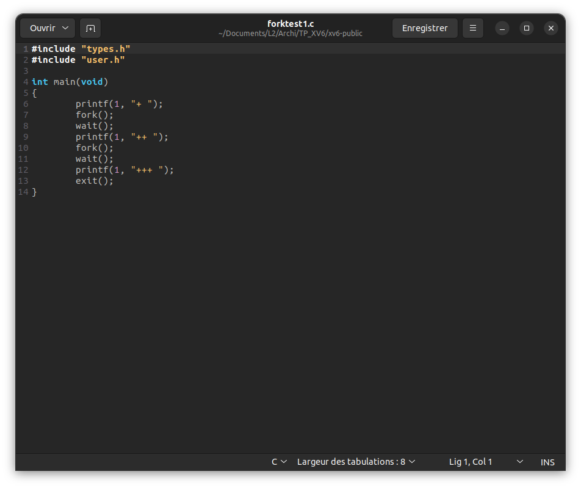
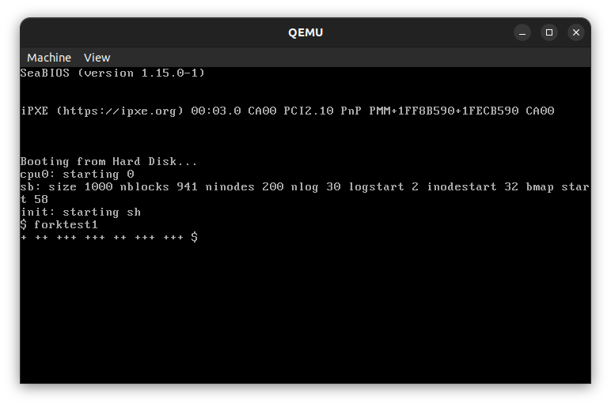
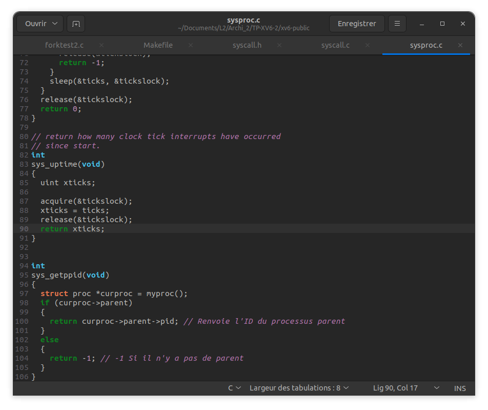
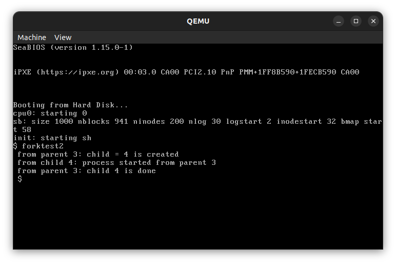
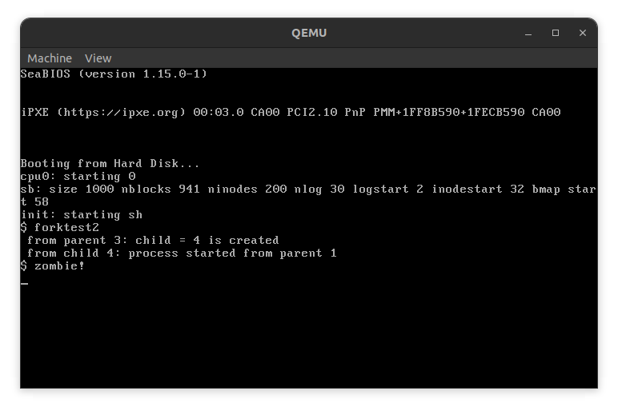
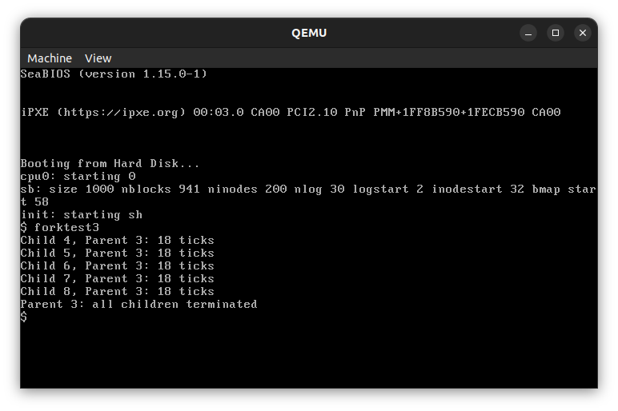
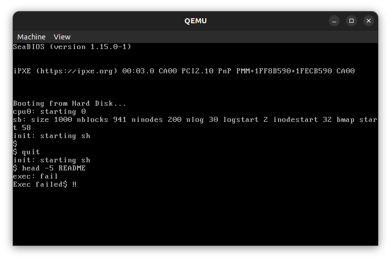

Patron Antoine - 22001126

# 1 Un premier test avec les “forks”
## Etape 1

## Etape 2


### Question 1
On peut observer que **lors de l'execution** de ce programme, il y a **7 processus** qui sont créer.</br>

### Question 2
L’arbre généalogique de tous les processus créés par ce programme est :
- P1 (<span style="color: #26B260">+</span> ++ +++ +++ ++ +++ +++)
  - P2 (+ <span style="color : #5bc0de">++</span>  +++ +++ ++ +++ +++)
    - P4 (+ ++ <span style="color: #d9534f">+++</span> +++ ++ <span style="color: #d9534f">+++</span> +++)
  - P3 (+ ++ +++ +++ <span style="color : #5bc0de">++</span> +++ +++)
    - P5 (+ ++ +++ <span style="color: #d9534f">+++</span> ++ +++ <span style="color: #d9534f">+++</span>)

# 2 Ajout d'une fonction noyau
## Etape 1
Ajout de la ligne suivante dans le fichier **"syscall.h"**
```c
#define SYS_getppid 22
```

## Etape 2
Ajout des lignes suivantes dans le fichier **"syscall.c"**
```c
extern int sys_getppid(void);
```
```c
[SYS_getppid] sys_getppid,
```

## Etape 3
Ajout de la fonction suivante dans le fichier **"sysproc.c"**


## Etape 4
Ajout de la ligne suivante dans le fichier **"usys.S"**
```c
SYSCALL(getppid)
```

## Etape 5
Ajout de la ligne suivante dans le fichier **"user.h"**
```c
int getppid(void);
```

# 3 Fonctionnement du **"fork"**
## Etape 3
Lors de l'utilisation de **"forktest2"**, on obtient le résultat suivant :


### Question 3
1. Le processus parent (ID 3) crée un processus enfant (ID 4) avec `fork()`.
2. Le processus parent attend que l'enfant se termine avec `wait()`.
3. Le processus enfant affiche un message montrant son ID et le parent (ID 3).
4. Le processus enfant se termine.
5. Le processus parent affiche un message indiquant que l'enfant (ID 4) s'est terminé.

### Question 4
Si l'on commente la ligne `wait()` et le printf associé, on obtient le résultat suivant :

Lorsque vous commentez le `wait()` et le `printf` associé dans le code, voici ce qui se passe :

1. Le processus parent (ID 3) crée un processus enfant (ID 4) avec `fork()`.
2. Le processus parent imprime le message "from parent 3: child = 4 is created" et n'attend pas que l'enfant se termine.
3. Le processus enfant (ID 4) imprime le message "from child 4: process started from parent 1". Ensuite, il se termine normalement en appelant `exit()`.
4. Cependant, comme le processus parent n'a pas de `wait()`, il n'attend pas que l'enfant se termine. Par conséquent, le processus enfant devient un "zombie" (un processus qui s'est terminé mais dont les informations de processus sont encore présentes en mémoire).
5. XV6 affiche "$ zombie!" pour indiquer la présence d'un processus zombie non géré. Un processus zombie consomme des ressources système jusqu'à ce que le parent exécute un `wait()` pour récupérer son statut de sortie, ce qui libère complètement les ressources du processus enfant. En l'absence de `wait()`, le système signale la présence d'un zombie.

# 4 Shynchronization
### Question 5
```c
#include "types.h"
#include "user.h"

// Fonction pour générer un nombre aléatoire de "ticks"
int generateRandomTicks(int *previousX, int a, int c, int m) {
    *previousX = (a * (*previousX) + c) % m;
    return *previousX;
}

int main()
{
    // Paramètres pour l'algorithme de congruence linéaire
    int a = 1664525;
    int c = 1013904223;
    int m = 32;

    int numChildren = 5;  // Nombre de processus fils à créer
    int previousX = c % m; // Initialisation pour l'algorithme de congruence linéaire

    // Création des processus fils
    for (int i = 0; i < numChildren; i++)
    {
        int pid = fork();
        if (pid == 0)
        {
                    // Processus fils
                    int numTicks = generateRandomTicks(&previousX, a, c, m);
                    printf(1, "Child %d, Parent %d: %d ticks\n", getpid(), getppid(), numTicks);
                    for (int j = 0; j < numTicks; j++) { sleep(1); }
                    exit();
            }
            
            else if (pid > 0)
            {
            // Processus parent
            continue;
        } 
        
        else
        {
             // Erreur
            printf(1, "Error: fork() failed\n");
            exit();
        }
    }
    
    // Attendre que tous les processus fils se terminent
    for (int i = 0; i < numChildren; i++) { wait(); }

    printf(1, "Parent %d: all children terminated\n", getpid());

    exit();
}
```
Cette fonction permet d'obtenir le resultat suivant :


# 5 Application : Créer votre propre Shell
Pour utiliser le Shell personnalisé, il faut remplacer le fichier **"sh.c"** par le fichier **"my_sh.c"** que l'on renomme **"sh.c"**.

Code de la fonction main :
```c
int main(void)
{
    while (1)
    {
        // TODO
        // Afficher le prompt
        printf(1, "$ ");
        
        // Lire la commande à partir de l'utilisateur
        memset(buf, 0, sizeof(buf));
        gets(buf, sizeof(buf));
        
        // Si la commande est vide, réafficher le prompt
        if (strlen(buf) <= 1)
            continue;
            
        // Analyser la commande
        struct cmd *cmd = parsecmd(buf);
        
        // Quitter le Shell si la commande est "quit"
        if (strcmp(cmd->argv[0], "quit") == 0)
        {
            free(cmd);
            break;
        }
        
        // Créer un nouveau processus pour exécuter la commande
        int pid = fork();

        if (pid < 0)
        {
            printf(1, "Fork failed");
        }
        else if (pid == 0)
        {
            // Processus fils
            exec(cmd->argv[0], cmd->argv);
        }
        else
        {
            // Processus parent
            wait();
        }
    }

    exit();
}
```
Resultat de la fonction :
