# Compte rendu TP4  Patron Antoine
## 1 FCFS
### étape 1
Ajout de la variable `int ctime;` dans la structure `struct proc` du fichier `proc.h`.</br>
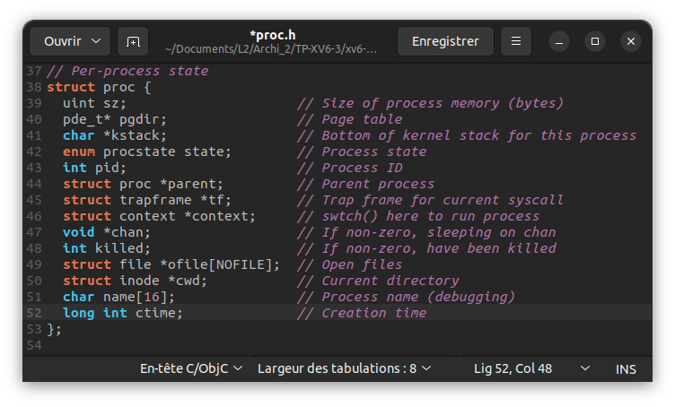</br>

### étape 2
Initialisation de la variable `p->ctime = ticks;` dans la fonction `allocproc()` du fichier `proc.c`.</br>
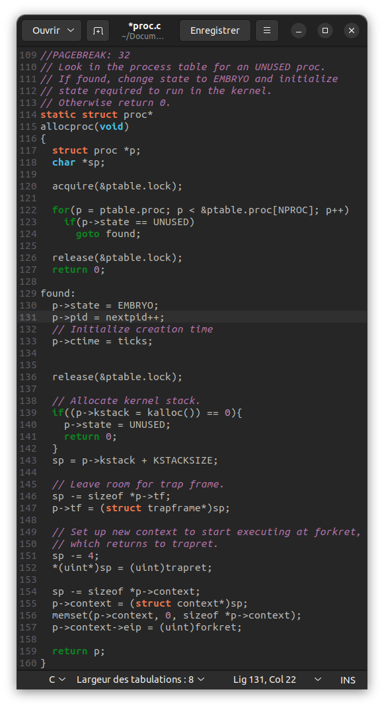</br>

### étape 3
Remplacement de la fonction `scheduler()` du fichier `proc.c` par la fonction suivante :</br>
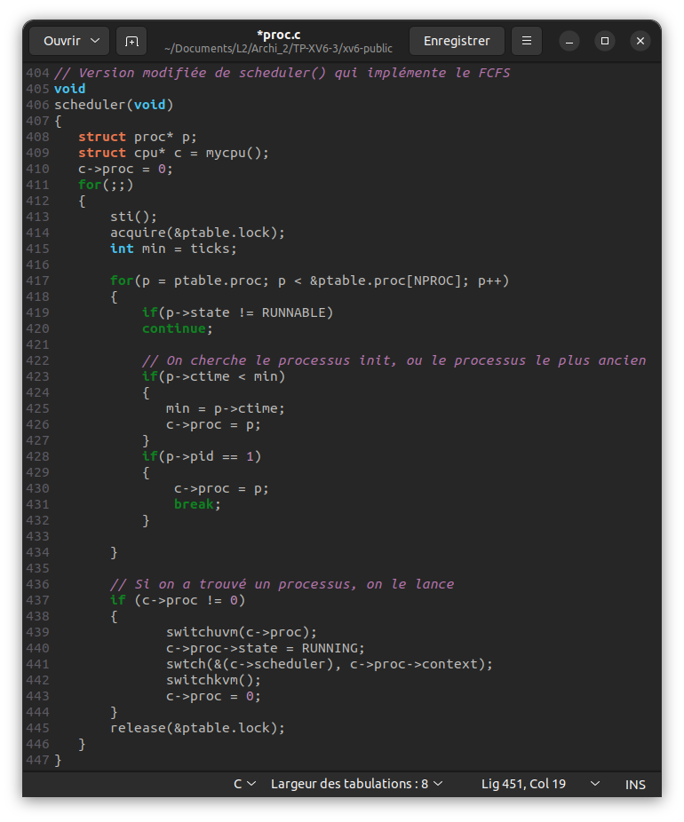</br>

### étape 4
Test du fonctionnement de l'algorithme FCFS grâce au programme `forktest4.c`, qui lance 10 processus en parallèle. Chaque processus trie 300 fois un tableau de 1000 valeurs entières.</br></br>
**Schduler d'origine de xv6 :**</br>
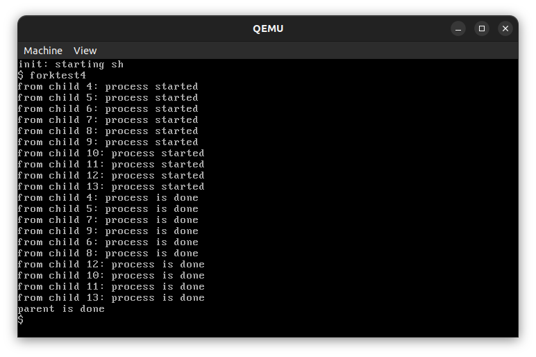</br>
**Schduler modifié avec l'algorithme FCFS :**</br>
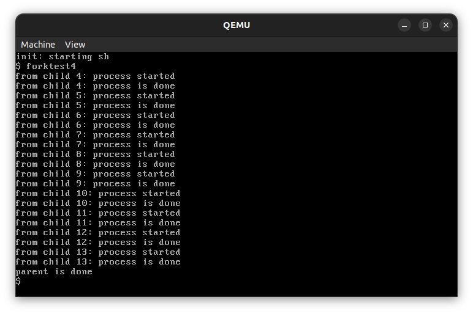</br>

## 2 Ordonnancement à base de priorités
### étape 1
Ajout de la variable `int priorite;` dans la structure `struct proc` du fichier `proc.h`.</br>
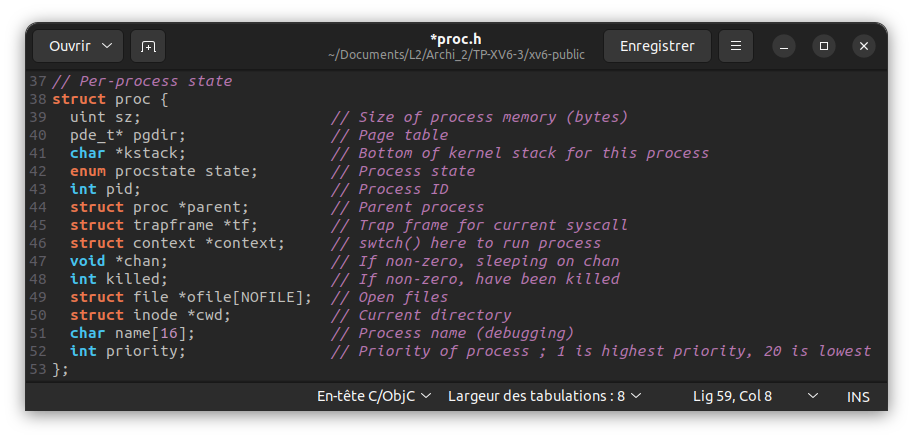</br>

### étape 2
Initialisation de la variable `p->priorite = 10;` dans la fonction `allocproc()` du fichier `proc.c`.</br>
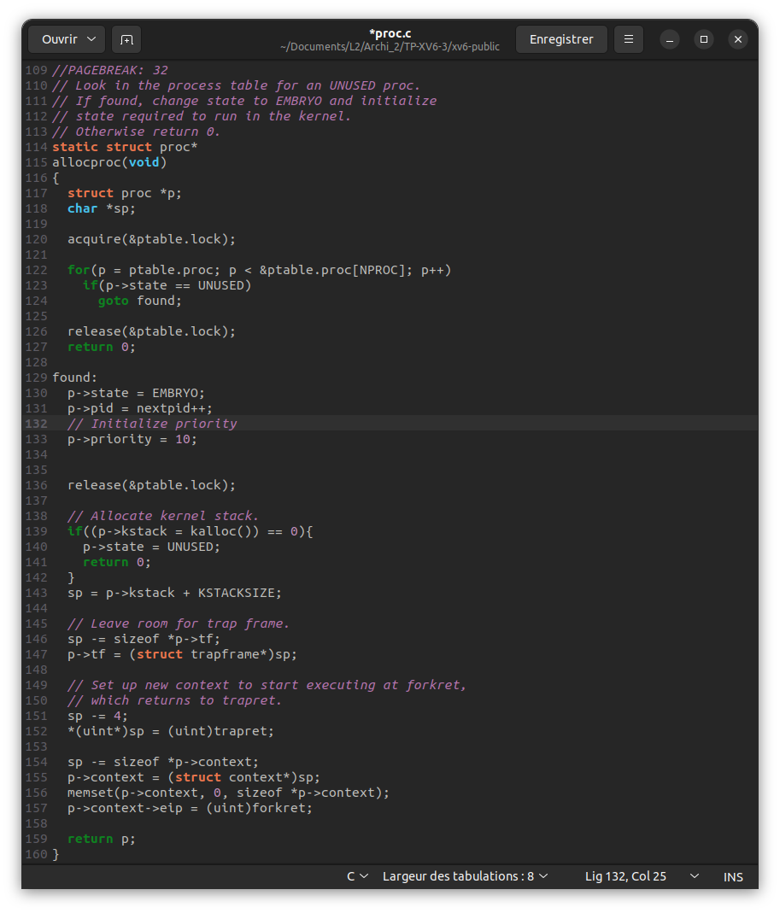</br>

### étape 3
#### Etape 3.1
Ajout de la ligne suivante dans le fichier `syscall.h` :</br>
```c
#define SYS_chpr 22
```

#### Etape 3.2
Ajout des lignes suivantes dans le fichier `syscall.c` :</br>
```c
extern int sys_chpr(void);
```
```c
[SYS_chpr] sys_chpr,
```

#### Etape 3.3
Ajout de la fonction suivante dans le fichier `sysproc.c` :</br>
```c
// Change priority
int sys_chpr(void)
{
    cprintf("sys_chpr called\n");
    int pid, priority;

    if(argint(0, &pid) < 0) { cprintf("error sys_chpr: argint pid is invalid, pid: %d must be positive\n", pid); return -1; }
    if(argint(1, &priority) < 0 || priority > 20) { cprintf("error sys_chpr: argint priority is invalid, priority: %d must be between 1 and 20\n", priority); return -1; }

    cprintf("sys_chpr: called chpr in proc.c with pid: %d and priority: %d\n", pid, priority);
    return chpr(pid, priority, 0);
}
```

#### Etape 3.4
Ajout de la ligne suivante dans le fichier `usys.S` :</br>
```c
SYSCALL(chpr)
```

#### Etape 3.5
Ajout de la ligne suivante dans le fichier `user.h` :</br>
```c
int chpr(int, int);
```

#### Etape 3.6
Ajout de la definition de la fonction `chpr()` dans le fichier `proc.h` :</br>
```c
int chpr(int pid, int priority, int verbose);
```

#### Etape 3.7
Ajout de la fonction `chpr()` dans le fichier `proc.c` :</br>
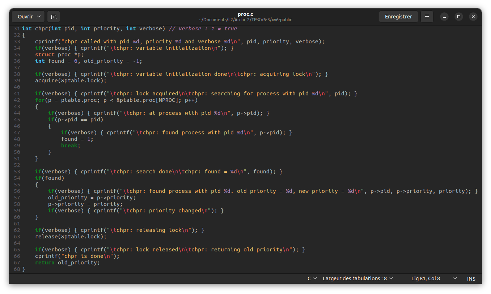</br>

### étape 4
Modification de la fonction `main()` du fichier `init.c` :</br>
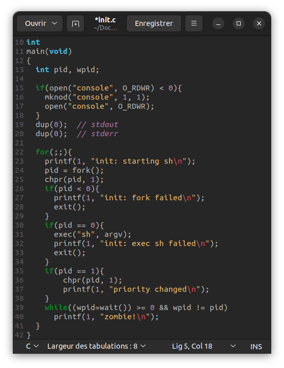</br>

### étape 5
Modification de la fonction `scheduler()` du fichier `proc.c` :</br>
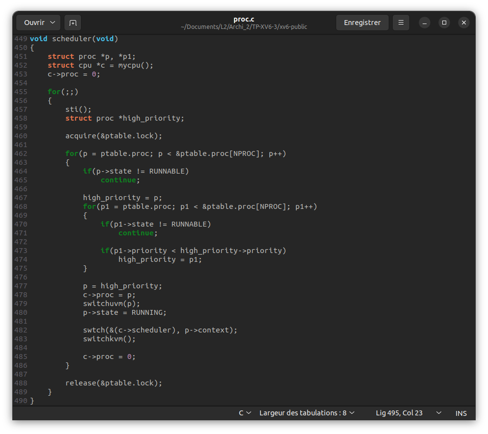</br>

### étape 6
Test du fonctionnement de l'algorithme à base de priorités grâce au programme `forktest5.c`, qui lance 10 processus en parallèle. Chaque processus trie 300 fois un tableau de 1000 valeurs entières, et modifie la priorité du dernier processus fils a 5.</br></br>
**Schduler d'origine de xv6 :**</br>
</br>

*Capture d'écran prise dans la console classique de Linux avec la commande `make qemu-nox` car celle de qemu ne permet pas d'afficher un grand nombre de lignes.*<br/>
**Schduler modifié avec l'algorithme à base de priorités :**</br>
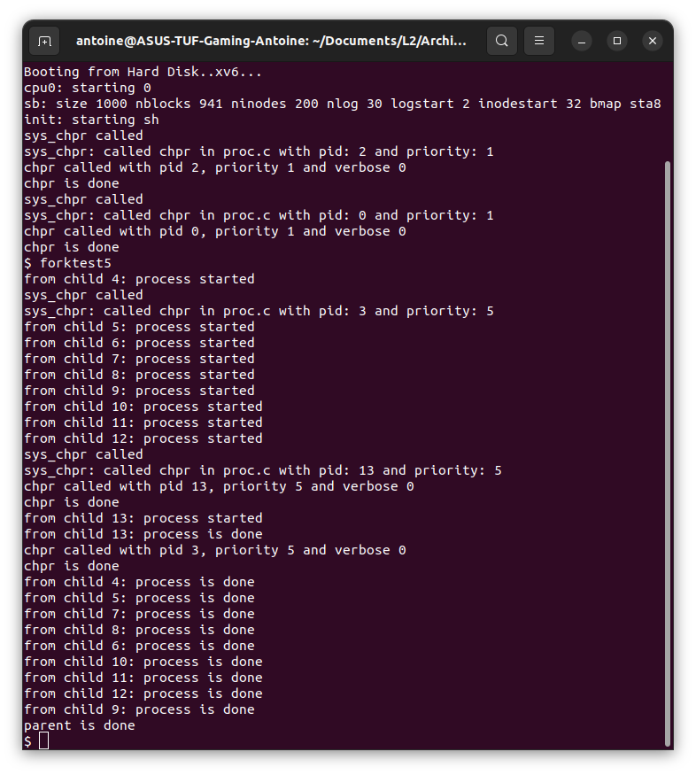</br>

## 3 Ordonnancement par loterie
### étape 1 - Modification de la structure `struct proc`
#### Etape 1.1
Modification de `struct proc` dans le fichier `proc.h` :</br>
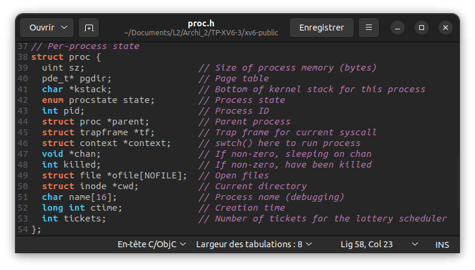</br>

#### Etape 1.2
Modification de la fonction `allocproc()` dans le fichier `proc.c` :</br>
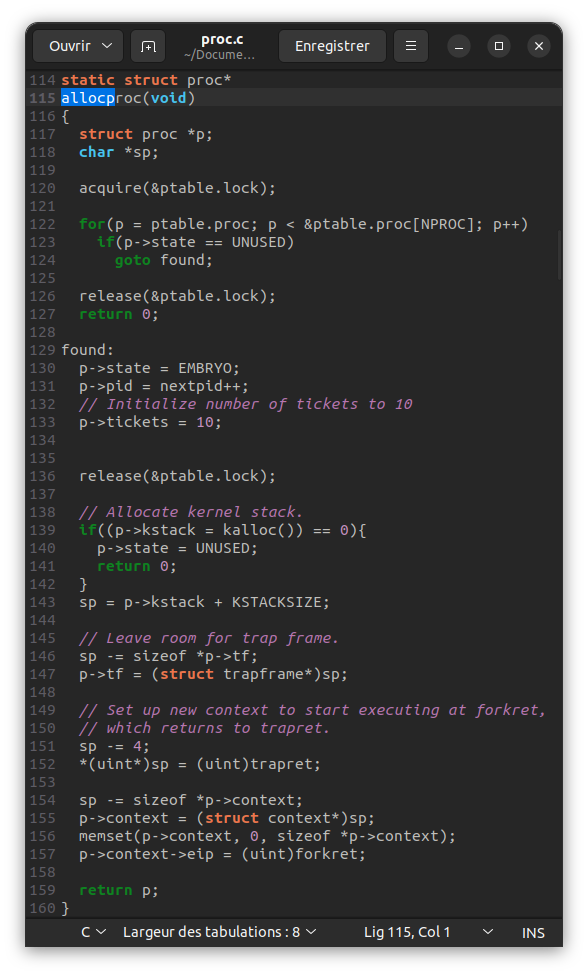</br>

### étape 2 - Ajout d'un appel système
#### Etape 2.1
Ajout de la ligne suivante dans le fichier `syscall.h` :</br>
```c
#define SYS_settickets 22
```

#### Etape 2.2
Ajout des lignes suivantes dans le fichier `syscall.c` :</br>
```c
extern int sys_settickets(void);
```
```c
[SYS_settickets] sys_settickets,
```

#### Etape 2.3
Ajout de la fonction suivante dans le fichier `sysproc.c` :</br>
```c
// Change ticket count
int
sys_settickets(void)
{
    cprintf("sys_tickets called\n");
    int pid, tickets;

    if(argint(0, &pid) < 0) { cprintf("error sys_tickets: argint pid is invalid, pid: %d must be positive\n", pid); return -1; }
    if(argint(1, &tickets) < 0 || tickets < 0) { cprintf("error sys_tickets: argint tickets is invalid, tickets: %d must be positive\n", tickets); return -1; }

    cprintf("sys_tickets: called tickets in proc.c with pid: %d and tickets: %d\n", pid, tickets);
    return settickets(pid, tickets, 0);
}
```

#### Etape 2.4
Ajout de la ligne suivante dans le fichier `usys.S` :</br>
```c
SYSCALL(settickets)
```

#### Etape 2.5
Ajout de la ligne suivante dans le fichier `user.h` :</br>
```c
int settickets(int, int);
```

#### Etape 2.6
Ajout de la definition de la fonction `settickets()` dans le fichier `proc.h` :</br>
```c
int settickets(int pid, int tickets, int verbose);
```

#### Etape 2.7
Ajout de la fonction `settickets()` dans le fichier `proc.c` :</br>
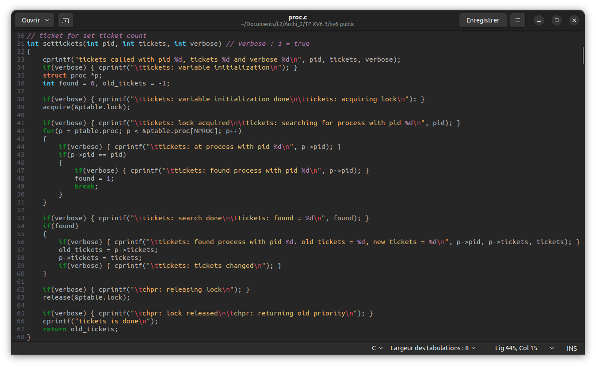</br>

### étape 3 - Ajouter le fichier du générateur aléatoires
Ajout de `rand.o\` dans `OBJS` dans le fichier `Makefile` :</br>

### étape 4 - Implémentation de l'algorithme de loterie
Modification de la fonction `scheduler()` dans le fichier `proc.c` :</br>
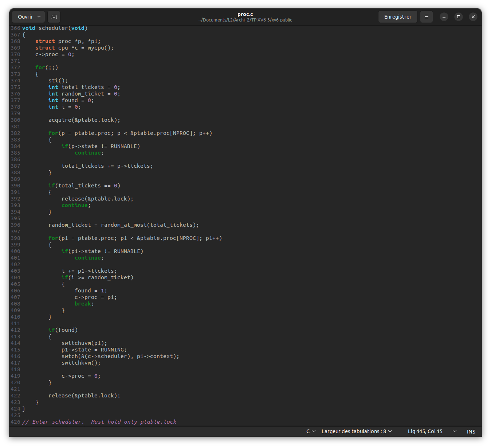</br>

### étape 5 - Test de l'algorithme de loterie
Test du fonctionnement de l'algorithme de loterie grâce au programme `forktest4.c`, qui lance 10 processus en parallèle. Chaque processus trie 300 fois un tableau de 1000 valeurs entières.</br></br>
**Schduler d'origine de xv6 :**</br>
</br>
**Schduler modifié avec l'algorithme de loterie (première exécution) :**</br>
</br>
**Schduler modifié avec l'algorithme de loterie (deuxième exécution) :**</br>
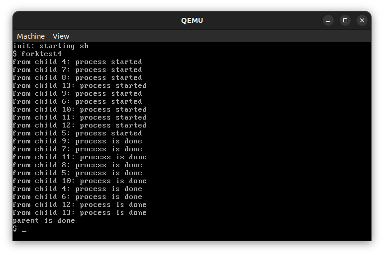</br>
On remarque clairement qu'avec l'algorithme de loterie, les processus ne sont pas exécutés dans le même ordre à chaque exécution.</br>

# Liste des fichiers modifiés
- ## Pour l'algorithme FCFS
    - proc.h
      - Ajout de la variable `int ctime;` dans la structure `struct proc`.
    - proc.c
      - Ajout de la variable `p->ctime = ticks;` dans la fonction `allocproc()`.
      - Remplacement de la fonction `scheduler()` par l'algorithme FCFS.
    - Makefile
      - Ajout du fichier `forktest4.c` dans la liste des fichiers à compiler.
- ## Pour l'algorithme à base de priorités
    - proc.h
      - Ajout de la variable `int priorite;` dans la structure `struct proc`.
      - Ajout de la définition de la fonction chpr : `int chpr(int pid, int priority, int verbose);`.
    - proc.c
      - Initialisation de la variable `p->priorite` a 10 dans la fonction `allocproc()`.
      - Ajout de la fonction `chpr()`.
      - Modification de la fonction `scheduler()`.
    - syscall.h
      - Ajout de la ligne `#define SYS_chpr 22`.
    - syscall.c
      - Ajout des lignes `extern int sys_chpr(void);` et `[SYS_chpr] sys_chpr,`.
    - sysproc.c
      - Ajout de la fonction `sys_chpr()`.
    - usys.S
      - Ajout de la ligne `SYSCALL(chpr)`.
    - user.h
      - Ajout de la ligne `int chpr(int, int);`.
    - init.c
      - Modification de la fonction `main()`.
    - Makefile
      - Ajout du fichier `forktest5.c` dans la liste des fichiers à compiler.
- ## Pour l'algorithme de loterie
    - proc.h
      - Ajout de la variable `int tickets;` dans la structure `struct proc`.
      - Ajout de la définition de la fonction settickets : `int settickets(int pid, int tickets, int verbose);`.
    - proc.c
      - Initialisation de la variable `p->tickets` a 10 dans la fonction `allocproc()`.
      - Ajout de la fonction `settickets()`.
      - Modification de la fonction `scheduler()`.
    - syscall.h
      - Ajout de la ligne `#define SYS_settickets 22`.
    - syscall.c
      - Ajout des lignes `extern int sys_settickets(void);` et `[SYS_settickets] sys_settickets,`.
    - sysproc.c
      - Ajout de la fonction `sys_settickets()`.
    - usys.S
      - Ajout de la ligne `SYSCALL(settickets)`.
    - user.h
      - Ajout de la ligne `int settickets(int, int);`.
    - Makefile
      - Ajout du fichier `rand.o` dans la liste des fichiers à compiler.