# Architecture et systèmes

## TP8 - Commandes Unix

### Exercice 1 - Systeme de fichiers

#### Q1 Créer un nouveau répertoire `tp_unix`

```bash
mkdir tp_unix
```

#### Q2 Créer un fichier vide `foo.txt` dans ce répertoire

```bash
touch tp_unix/foo.txt
```

#### Q3 Copiez le fichier `foo.txt` dans un fichier `foo.txt.copy`

```bash
cd tp_unix
cp foo.txt foo.txt.copy
```

#### Q4 Renommez le fichier `foo.txt.copy` en `foo2`

```bash
mv foo.txt.copy foo2
```

#### Q5 Dplacez le fichier `foo2` dans le sous-répertoire `data` (préalablement créé)

```bash
mkdir data
mv foo2 data
```

#### Q6 Créez un nouveau sous-répertoire appelé `new` dans le répertoire `tp_unix`

```bash
mkdir new
```

#### Q7 Déplacez le fichier `foo2` du répertoire `data` vers le répertoire `new`

```bash
mv data/foo2 new
```

#### Q8 Déplacez le fichier `foo2` du répertoire `new` dans le répertoire `tp_unix` et changez le nom en `foo.old`

```bash
mv new/foo2 foo.old
```

#### Q9 Affichez l'arborescence complète avec seulement les répertoires

```bash
cd ..
tree -d tp_unix
```

#### Q10 Supprimez le fichier `foo.old`

```bash
rm tp_unix/foo.old
```

#### Q11 Supprimez le sous-répertoire `new`

```bash
rmdir tp_unix/new
```

### Exercice 2 - Affichage des répertoires

#### Q1 Quelle est l'option `ls` pour lister tous les fichiers ? Faites le test à la racine de votre compte

L'option `-a` permet de lister tous les fichiers.

```bash
cd
ls
```
Résultat :

[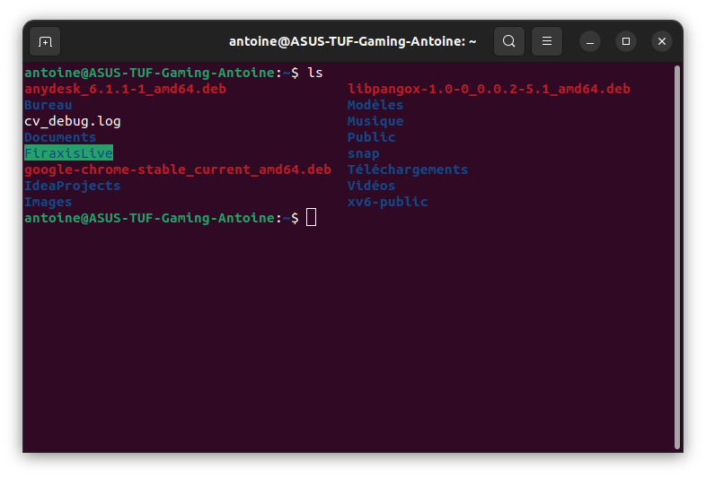](Images/Exo2/E2_Q1_1.png)

```bash
ls -a
```
Résultat :

[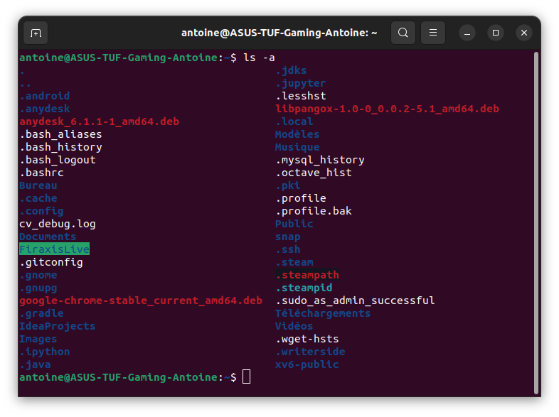](Images/Exo2/E2_Q1_2.png)

#### Q2 Quels fichiers voyez-vous si on ajout l'option `-a` que vous ne voyez pas avec `ls` seul ?

L'option `-a` permet de lister les fichiers cachés.

[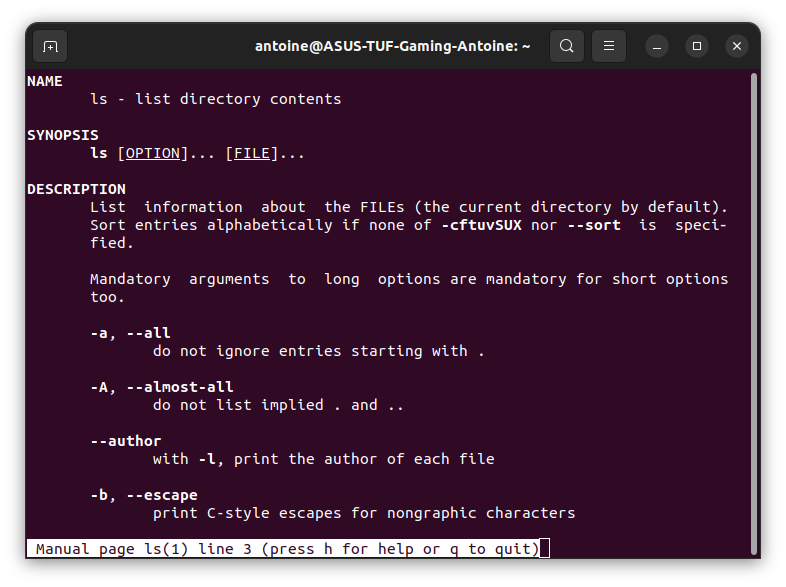](Images/Exo2/E2_Q2.png)

#### Q3 Quelle est l'option `ls` pour lister tous les fichiers dans tous les sous-répertoires ?

L'option `-R` permet de lister tous les fichiers dans tous les sous-répertoires.

```bash
ls -R
```
Résultat :

[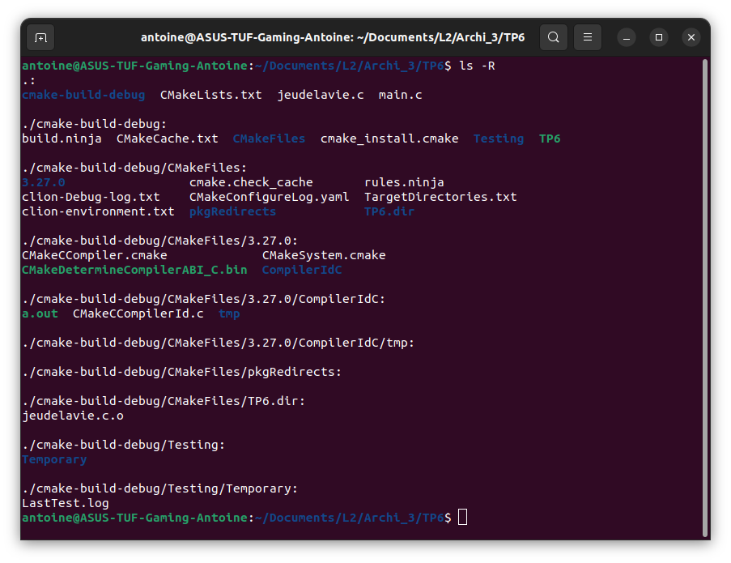](Images/Exo2/E2_Q3.png)

#### Q4 Répertoriez tous les fichiers du répertoire `/dev` contenant `tty` dans le nom du fichier

```bash
ls /dev/*tty*
```
Résultat :

[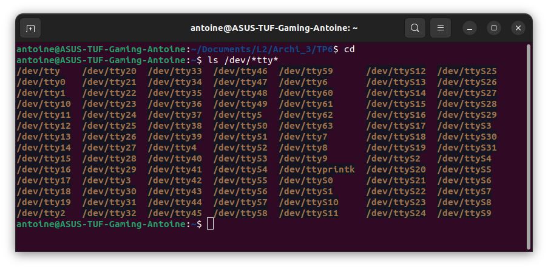](Images/Exo2/E2_Q4.png)

### Exercice 3 - Manipulation du contenu d'un fichier

#### Q1 Affichez la totalité du contenu du fichier `/etc/adduser.conf` dans la console

```bash
cat /etc/adduser.conf
```
Résultat :

[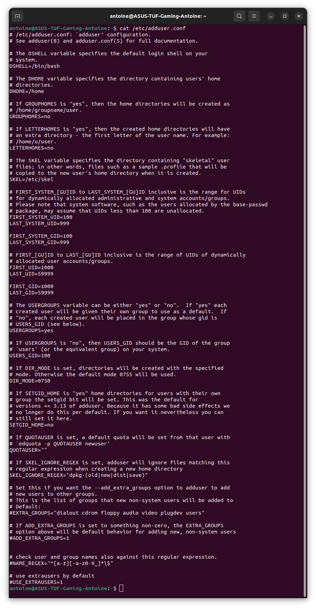](Images/Exo3/E3_Q1.png)

#### Q2 Affichez page par page le contenu du fichier `/etc/adduser.conf` dans la console

```bash
cat /etc/adduser.conf | more
```
Résultat :

[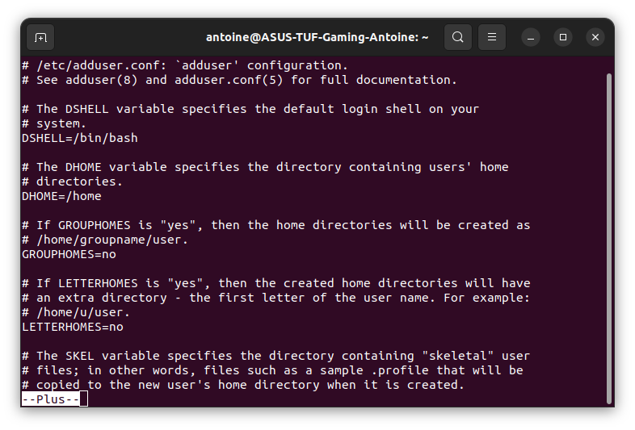](Images/Exo3/E3_Q2.png)

#### Q3 Déplacez-vous dans le contenu du fichier `/etc/adduser.conf` affiché dans la console

```bash
cat /etc/adduser.conf | less
```
Résultat :

[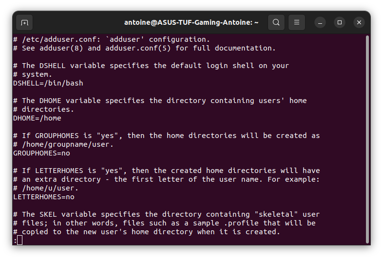](Images/Exo3/E3_Q3.png)

#### Q4 Affichez le contenu du fichier `/etc/adduser.conf` avec les numéros de ligne

```bash
cat -n /etc/adduser.conf
```
Résultat :

[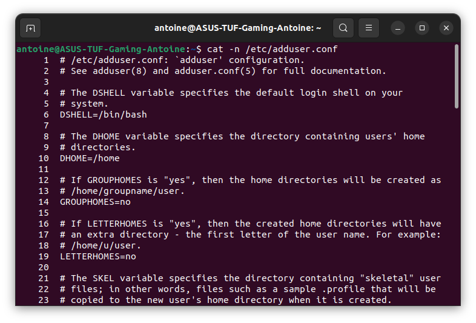](Images/Exo3/E3_Q4.png)

#### Q5 Recherchez le mot `group` en utilisant la commande de la question précédente ; le mot `̀group` doit apparaître en surbrillance

```bash
cat -n /etc/adduser.conf | grep -i group
```
Résultat :

[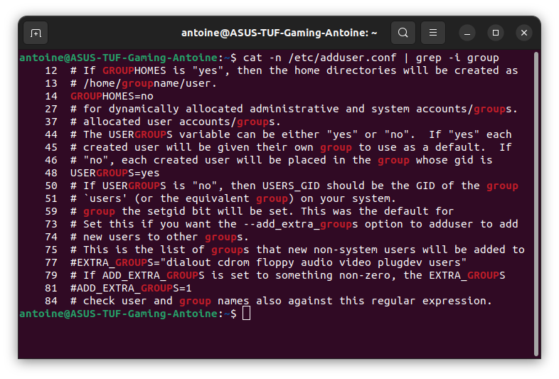](Images/Exo3/E3_Q5.png)

#### Q6 Affichez les 10 premières lignes du fichier `/var/log/syslog` (attention, il faut exécuter cette commande en super-utilisateur)

```bash
sudo head /var/log/syslog
```
Résultat :

[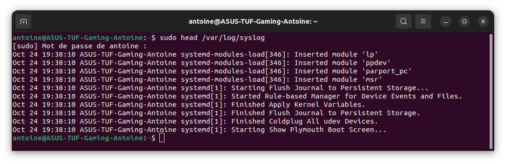](Images/Exo3/E3_Q6.png)

#### Q7 Affichez les 10 dernières lignes du fichier `/var/log/syslog` (attention, il faut exécuter cette commande en super-utilisateur)

```bash
sudo tail /var/log/syslog
```
Résultat :

[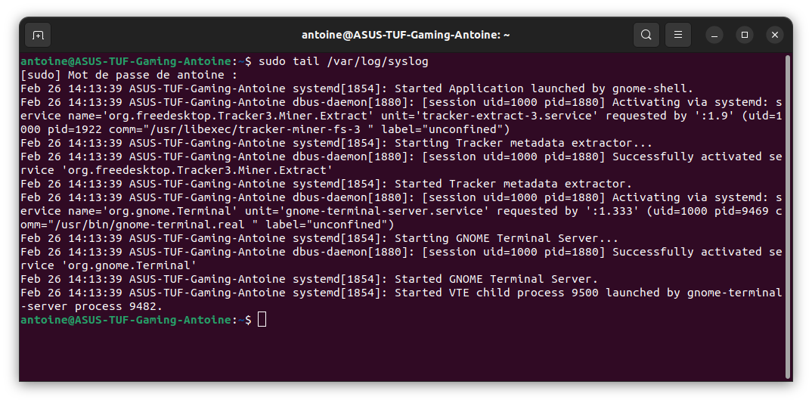](Images/Exo3/E3_Q7.png)

#### Q8 Affichez le nombre de lignes, de mots et de caractères du fichier `/etc/passwd`

```bash
wc /etc/passwd
```
Résultat :

[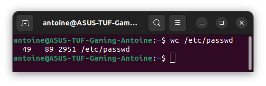](Images/Exo3/E3_Q8.png)

#### Q9 Comment faire pour que cette commande n’affiche que le nombre de lignes ?

```bash
wc -l /etc/passwd
```
Résultat :

[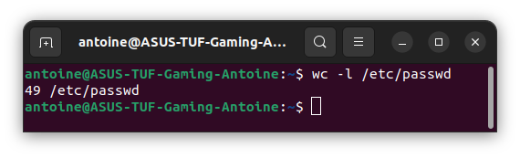](Images/Exo3/E3_Q9.png)

### Exercice 4 - Recherche dans du texte

#### Q1 Recherchez toutes les entrées du fichier `/var/log/syslog` qui fait apparaître le mot `kernel` (attention, il faut être en mode super-utilisateur)

```bash
sudo grep -i kernel /var/log/syslog
```
Résultat :

[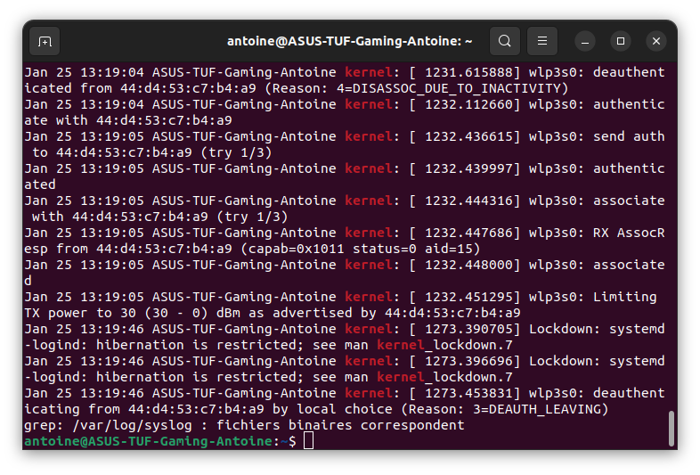](Images/Exo4/E4_Q1.png)

#### Q2 Recherchez toutes les lignes commençant par `#include` dans le fichier `/usr/include/c++/8/numeric` (le 8 peut être remplacé par un autre chiffre selon votre version de compilateur C++)

```bash
grep -i "^#include" /usr/include/c++/8/numeric
```
Résultat :

[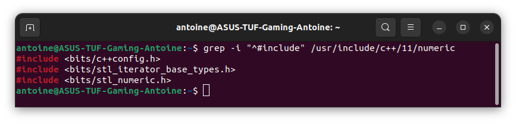](Images/Exo4/E4_Q2.png)

#### Q3 Recherchez toutes les entrées du fichier `/var/log/syslog` qui fait font apparaître des heures comprises entre `13h` et `13h59min59s`

```bash
grep -i " 13:[0-5][0-9]:[0-5][0-9]" /var/log/syslog
```
Résultat :

[![grep -i " 13:[0-5][0-9]:[0-5][0-9]" /var/log/syslog](Images/Exo4/E4_Q3.png)](Images/Exo4/E4_Q3.png)

#### Q4 En faisant la même recherche que précédemment, indiquez le nombre de lignes trouvées

```bash
grep -i " 13:[0-5][0-9]:[0-5][0-9]" /var/log/syslog | wc -l
```
Résultat :

[![grep -i " 13:[0-5][0-9]:[0-5][0-9]" /var/log/syslog | wc -l](Images/Exo4/E4_Q4.png)](Images/Exo4/E4_Q4.png)

#### Q5 Dans le fichier `/var/log/messages` ou `/var/log/dmesg`, trouvez les lignes faisant références aux erreurs de type `error`, `warn`, ou `failed`

```bash
grep -i "error\|warn\|failed" /var/log/messages
```
Résultat :

[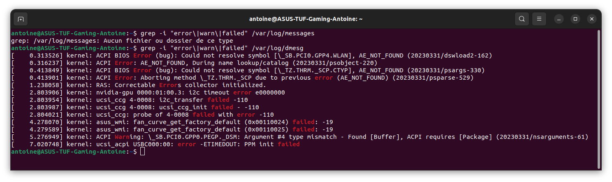](Images/Exo4/E4_Q5.png)

#### Q6 A l’aide du fichier `/etc/services`, trouvez le protocole et le port du service ftp ; seul le service ftp doit apparaître

```bash
grep -i "^ftp" /etc/services
```
Résultat :

[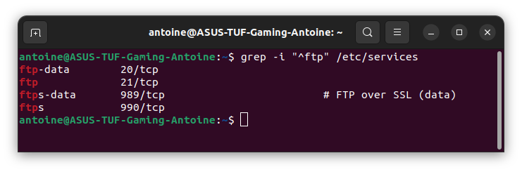](Images/Exo4/E4_Q6.png)

#### Q7 Identifiez dans le fichier `/etc/passwd` vos informations de connexion ( par exemple, le chemin de votre compte, votre interpréteur de commandes)

```bash
grep -i <nom_utilisateur> /etc/passwd
```
Résultat :

[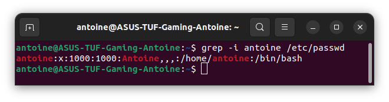](Images/Exo4/E4_Q7.png)

### Exercice 5 - Systeme et devices

#### Q1 Déterminez le modèle de votre processeur et le nombre de coeurs (utiliser un fichier du répertoire `/proc`)

```bash
cat /proc/cpuinfo | grep -i "model name\|cpu cores" | head -n 2
```
Résultat :

[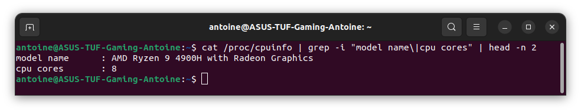](Images/Exo5/E5_Q1.png)

#### Q2 Affichez uniquement les caractéristiques mémoires (utiliser un fichier du répertoire `/proc`)

```bash
cat /proc/meminfo | grep -i "memtotal\|memfree"
```
Résultat :

[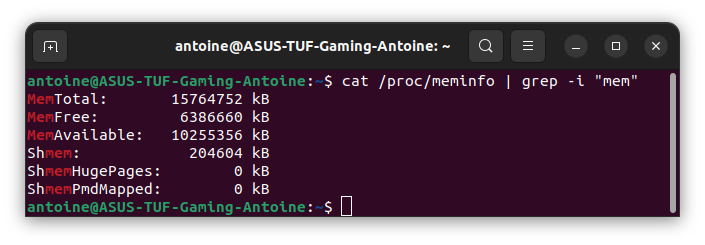](Images/Exo5/E5_Q2.png)

#### Q3 Quels sont les devices orientés caractères dans le répertoire `/dev` ?

```bash
ls -l /dev | grep "^c"
```
Résultat :

[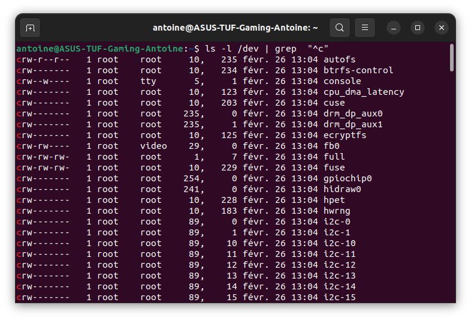](Images/Exo5/E5_Q3.png)

#### Q4 Quel est le nom de votre device disque ?

```bash
lsblk
```
Résultat :

[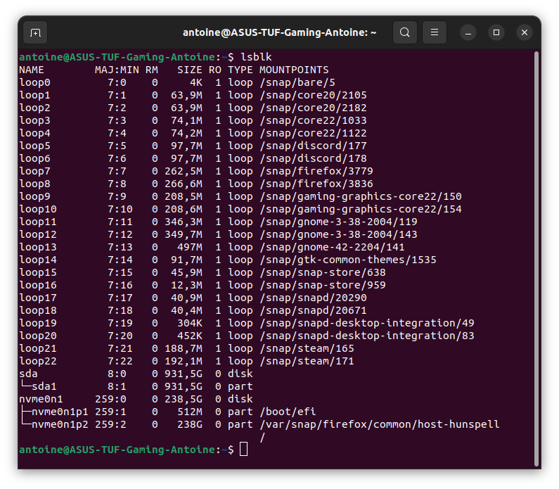](Images/Exo5/E5_Q4.png)

#### Q5 Quel est l’espace libre et occupé de votre disque ?

```bash
df -h
```
Résultat :

[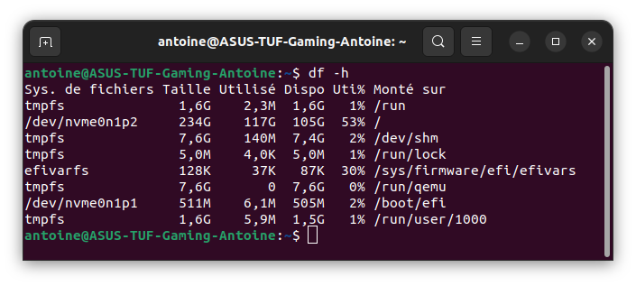](Images/Exo5/E5_Q5.png)

#### Q6 Quel est la quantité de mémoire libre et utilisée dans le système ?

```bash
free -h
```
Résultat :

[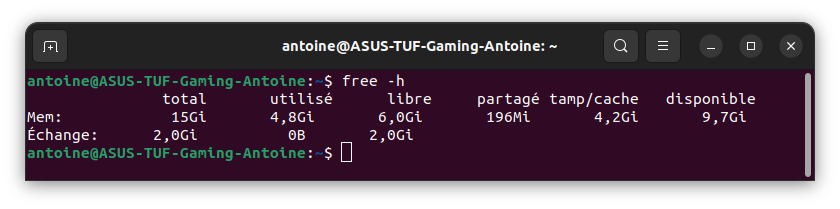](Images/Exo5/E5_Q6.png)

#### Q7 Quelle est la charge de votre processeur lors des 5 dernières minutes ?

```bash
uptime
```
Résultat :

[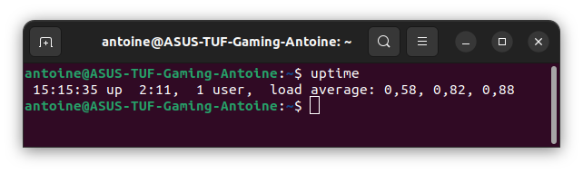](Images/Exo5/E5_Q7.png)

#### Q8 Quel est le nom de votre machine ?

```bash
uname -n
```
Résultat :

[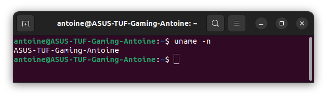](Images/Exo5/E5_Q8.png)

#### Q9 Quelle est la version du noyau Linux de votre distribution ?

```bash
uname -r
```
Résultat :

[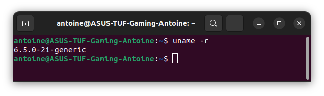](Images/Exo5/E5_Q9.png)

### Exercice 6 - Processus

#### Q1 Découvrez les processus en cours d’exécution en utilisant `top` (ou `htop`) et identifiez le processus qui utilise le plus le processeur

```bash
top
```
Le processus qui utilise le plus le processeur est `jetbrains-toolbox`

Résultat :

[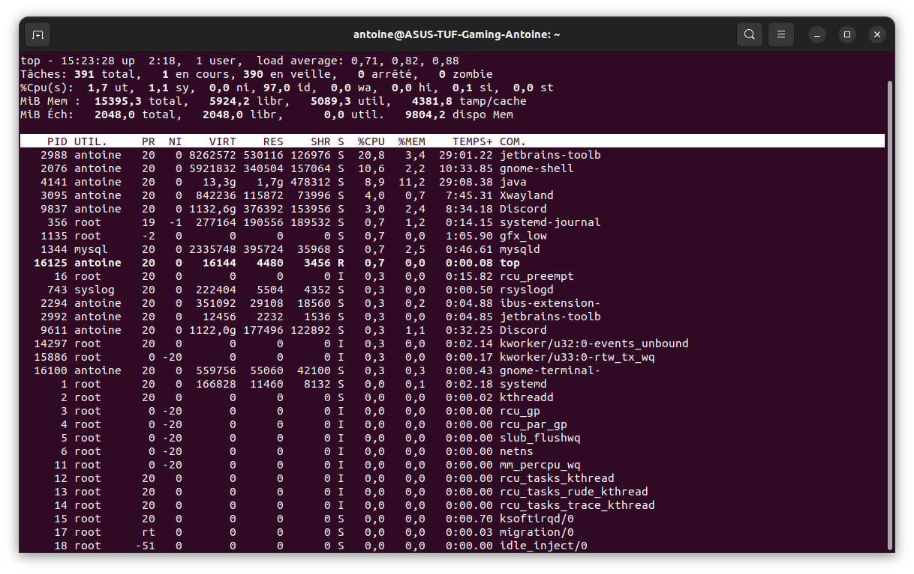](Images/Exo6/E6_Q1.png)

#### Q2 Quelle est la quantité de mémoire utilisée ?

Jetbrains-toolbox utilise au moment de la capture d'écran 3.4% de la mémoire.

#### Q3 Identifier le ou les processus en mode `running`

```bash
ps -r
```
Résultat :

[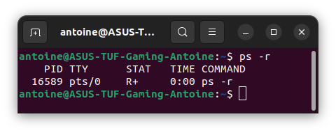](Images/Exo6/E6_Q3.png)

#### Q4 Notez le temps CPU utilisé par le processus top ou htop

```bash
top
```
Résultat :

[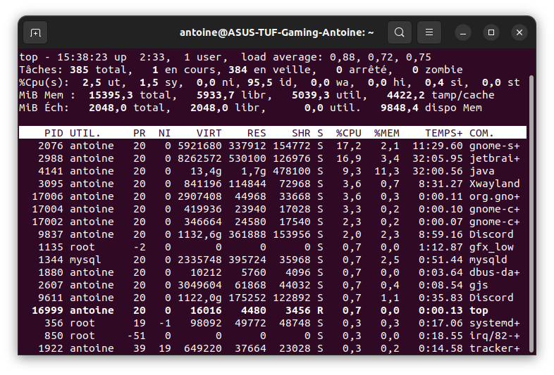](Images/Exo6/E6_Q4.png)

On peut voir que le temps CPU utilisé par le processus `top` est de 0:00.13

#### Q5 Lancez à l’aide de deux techniques différentes depuis la console un programme en "background" (par exemple, le téléchargement d’une distribution)

```bash
wget release.ubuntu.com/22.04/ubuntu-22.04-desktop-amd64.iso
```

#### Q6 Identifier le PID du processus exécutable le programme en "background"

```bash
ps -e | grep wget
```

#### Q7 Stopper l’exécution du processus identifié depuis la console

```bash
kill <PID>
```

#### Q8 Quel est le propriétaire et le PID du processus `cron` ?

```bash
ps -e | grep cron
```
Résultat :

[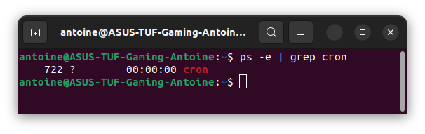](Images/Exo6/E6_Q8.png)

Le PID de ce processus est 722 et le propriétaire est root.

### Exercice 7 - Recherche et fitre

#### Q1 Utilser `find` pour afficher les noms de tous les fichiers dans l'arborecence du sous-répertoire `/var/log`

```bash
find /var/log -type f
```
Résultat :

[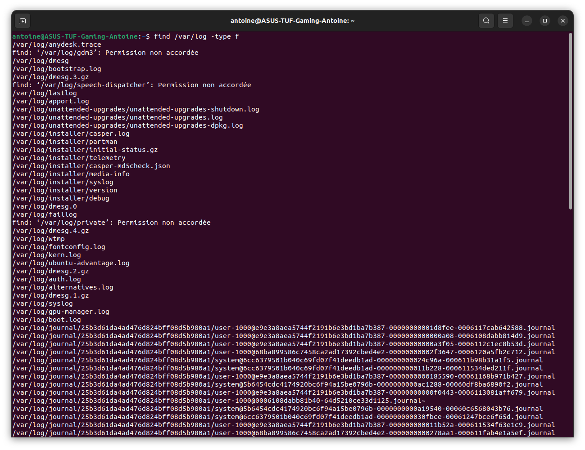](Images/Exo7/E7_Q1.png)

#### Q2 Pouvez vous faire cela sans les erreurs pour les fichiers que vous ne pouvez pas lire ? Attention, il faut rediriger la sortie erreur

```bash
find /var/log -type f 2>/dev/null
```
Résultat :

[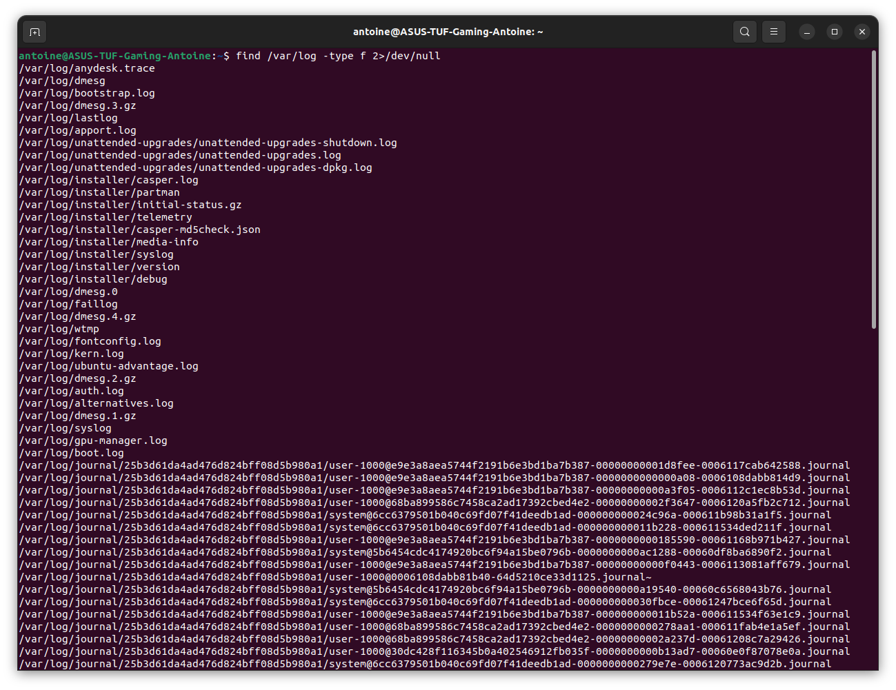](Images/Exo7/E7_Q2.png)

#### Q3 Complétez la commande précédente afin de trier les fichiers par ordre alphabétique

```bash
find /var/log -type f 2>/dev/null | sort
```
Résultat :

[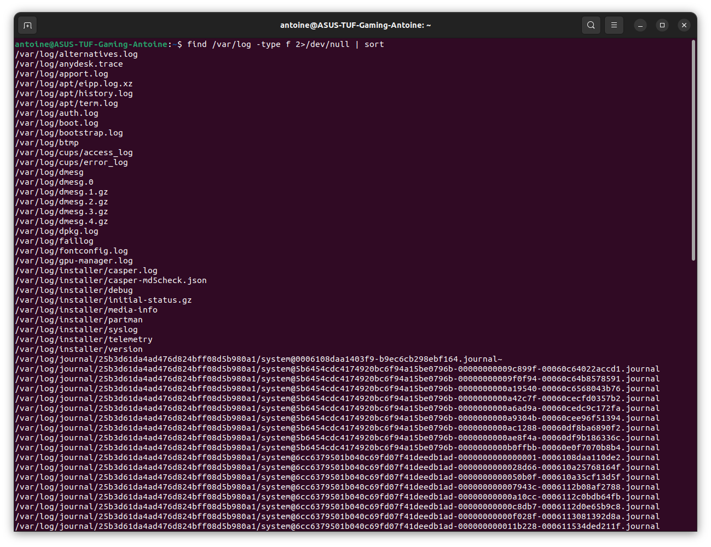](Images/Exo7/E7_Q3.png)

#### Q4 Afficher tous les fichiers de `/var/log` dont la taille dépasse 1Mo

```bash
find /var/log -type f -size +1M
```
Résultat :

[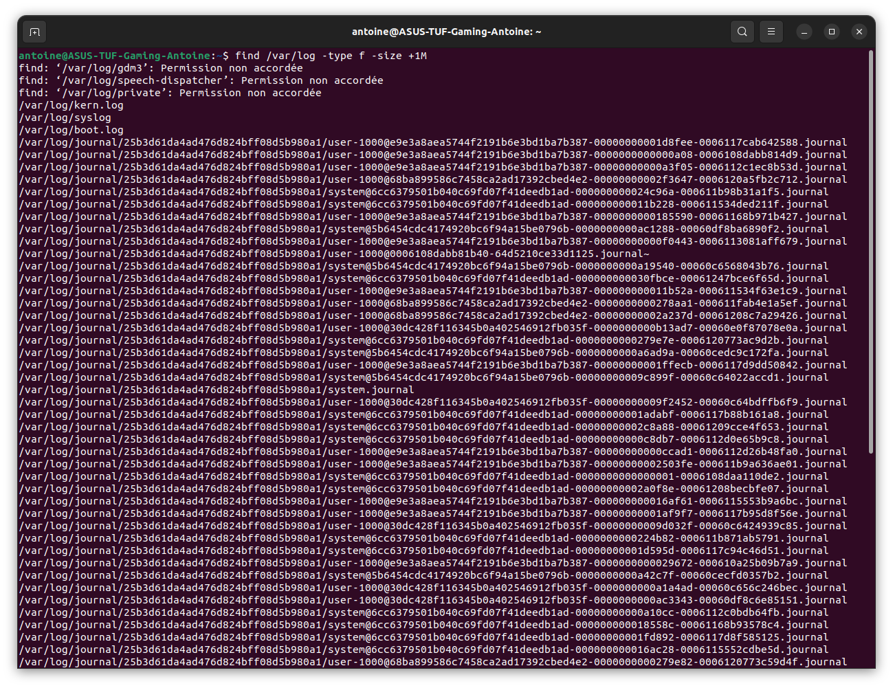](Images/Exo7/E7_Q4.png)

#### Q5 Trouver tous les fichiers de type `gzip` dans `/var/log`

```bash
find /var/log -type f -name "*.gz"
```
Résultat :

[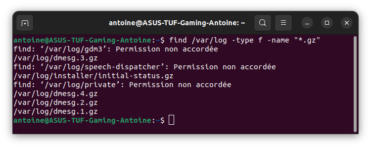](Images/Exo7/E7_Q5.png)

#### Q6 Utilisez `find`, `grep` et `sort` pour afficher une liste triée de tous les fichiers de l'arborecence du sous-répertoire `/var/log` qui contiennent le mot `gnome` quelque part à l'intérieur

```bash
find /var/log -type f -exec grep -l "gnome" {} \; | sort
```
Résultat :

[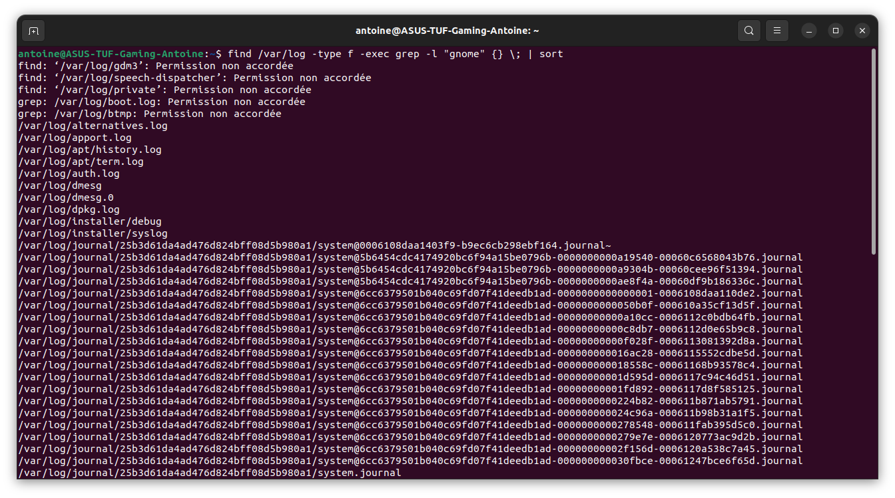](Images/Exo7/E7_Q6.png)

#### Q7 Modifiez la commande precedante pour connaitre le nombre d'occurences de `gnome` dans les mêmes conditions de recherche

```bash
find /var/log -type f -exec grep -l "gnome" {} \; | sort | xargs grep -c "gnome"
```
Résultat :

[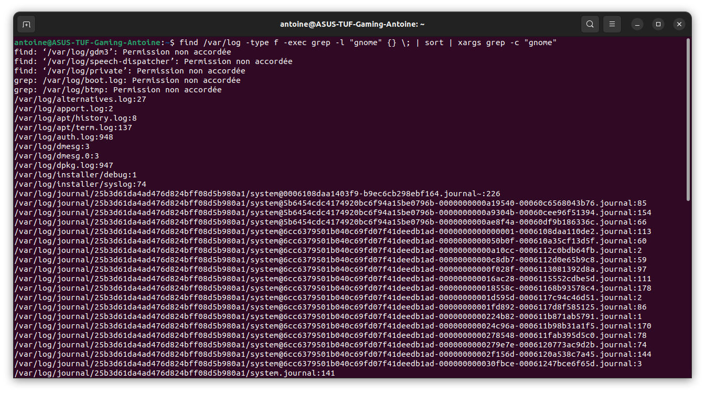](Images/Exo7/E7_Q7.png)

#### Q8 Utilisez `locate` pour trouver tous les noms de fichiers contenant le mot `nano`

```bash
locate nano
```
Résultat :

[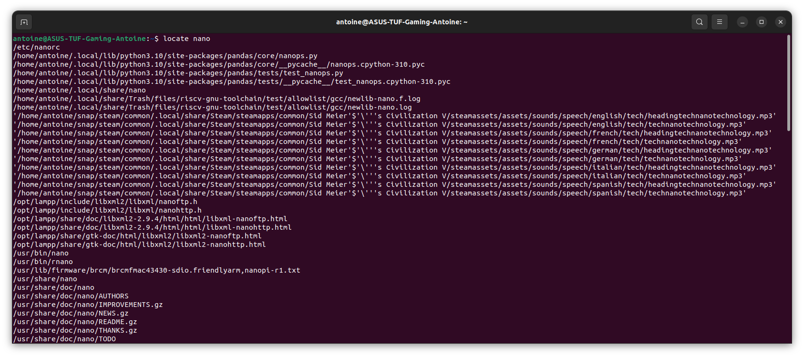](Images/Exo7/E7_Q8.png)

#### Q9 Pouvez-vous combiner cela avec `grep` pour eviter d'afficher les tous les nom de fichiers contenant le mot `share` ?

```bash
locate nano | grep -v "share"
```

#### Q10 Comptez le nombre de lignes lignes de chaque fichier du répertoire `/usr/share` et de ses sous-répertoires dont l'extension est `.sh`

```bash
find /usr/share -type f -name "*.sh" -exec wc -l {} \;
```
Résultat :

[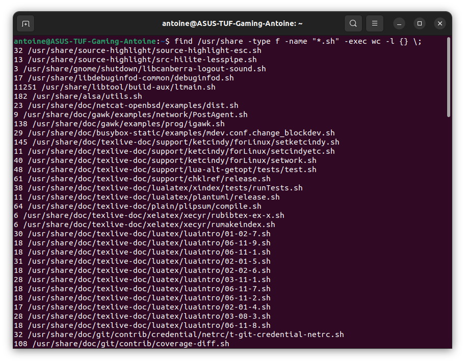](Images/Exo7/E7_Q10.png)

### Exercice 8 - Archive et compression

#### Q1 Archivez le contenu de l'un de vos répertoires (y compris les sous-répertoires) en utilisant `tar`

```bash
cd Documents/L2/Archi_3
tar -cvf TP6.tar TP6
```
Résultat :

[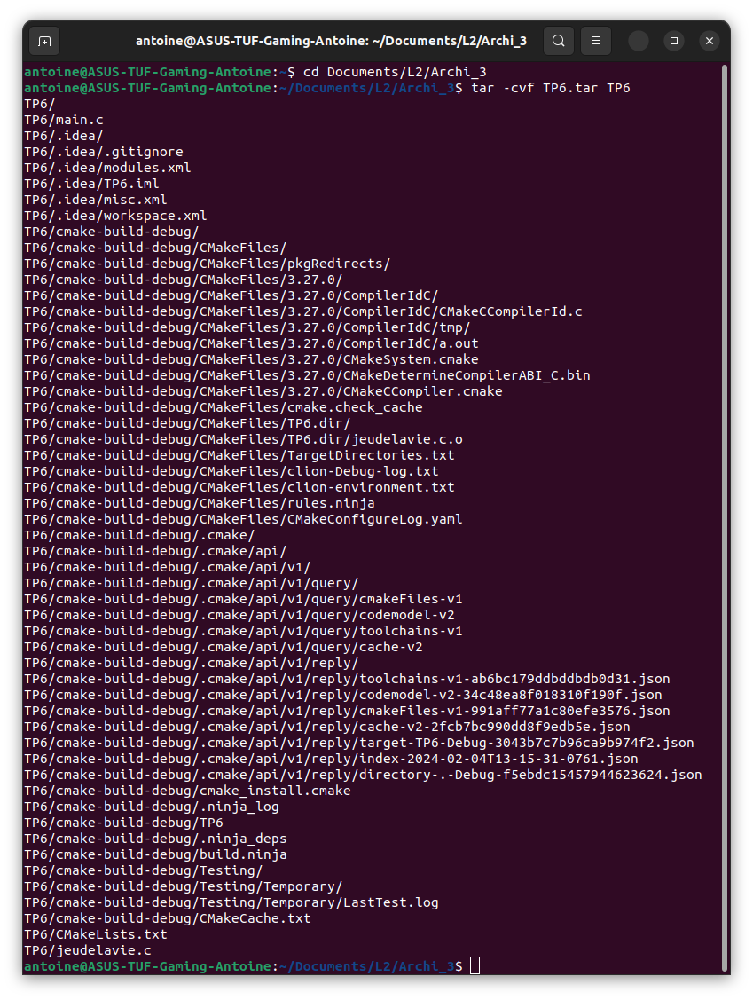](Images/Exo8/E8_Q1.png)

#### Q2 Compressez l'archive produite par `tar` avec `gzip`; l'extension du fichier doit être conforme a son contenu

```bash
gzip TP6.tar
```
Résultat :

[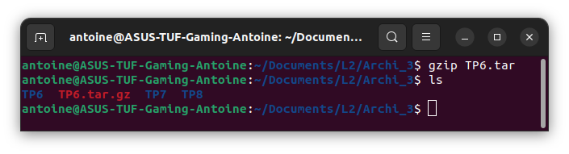](Images/Exo8/E8_Q2.png)

#### Q3 Créez un répertoire `tmp` à la racine de votre répertoire personnel et décompressez et désarchivez le fichier produit précédemment

```bash
mkdir ~/tmp
mv TP6.tar.gz ~/tmp
cd ~/tmp
tar -xvzf TP6.tar.gz
```
Résultat :

[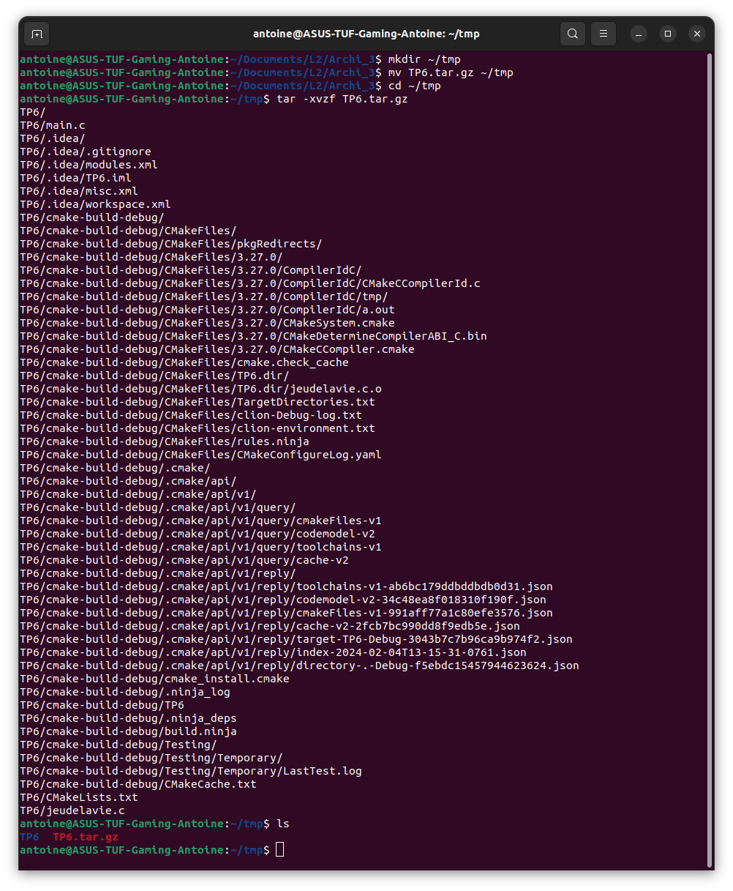](Images/Exo8/E8_Q3.png)

### Exercice 9 - Droits

#### Q1 Créer l’arborescence suivante en root
```bash
.
| - - d_root
    | - - a
    |   | - - c
    |       | - - d
    |       | - - e
    | - - b
```

```bash
sudo mkdir -p /d_root/a/c/d
sudo mkdir -p /d_root/a/c/e
sudo mkdir -p /d_root/b
```
Résultat :

[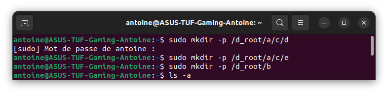](Images/Exo9/E9_Q1.png)

#### Q2 Repassez en user "student" et créez un fichier vide dans le répertoire e ; s’il y a un souci, que doit-on faire ? Attention, le fichier doit appartenir au user "student"

```bash
touch /d_root/a/c/e/file.txt
```
Le dossier `e` appartient à root, il est donc impossible de créer un fichier dans ce répertoire. Pour résoudre ce problème, il faut changer les droits du répertoire `e` pour qu'il appartienne à l'utilisateur `student`.

```bash
sudo chown student /d_root/a/c/e
```
Résultat :

[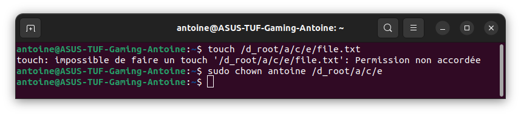](Images/Exo9/E9_Q2.png)

#### Q3 En mode root, créez un fichier vide dans le répertoire d ; repassez en user "student", tentez d’ouvrir le fichier avec nano

```bash
sudo touch /d_root/a/c/d/file.txt
```
Résultat :

[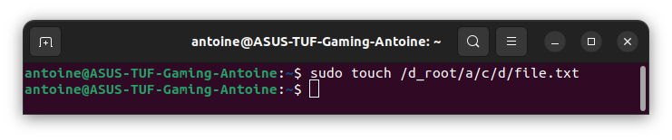](Images/Exo9/E9_Q3_1.png)

```bash
nano /d_root/a/c/d/file.txt
```
Résultat :

[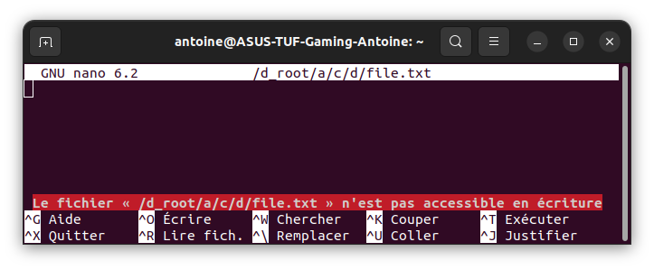](Images/Exo9/E9_Q3_2.png)

On peut voir que le fichier est accessible uniquement en lecture.

#### Q4 A l’aide de nano, écrivez dans le fichier du répertoire d ; s’il y a un souci, changez les droits du fichier

```bash
sudo chmod 777 /d_root/a/c/d/file.txt
nano /d_root/a/c/d/file.txt
```
Résultat :

[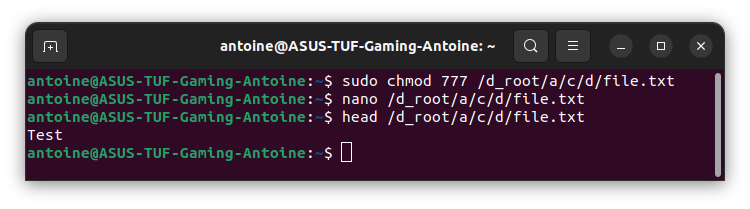](Images/Exo9/E9_Q4.png)


#### Q5 Rendez le répertoire b inacessible au user "student"

```bash
sudo chmod 000 /d_root/b
touch /d_root/b/file.txt
```
Résultat :

[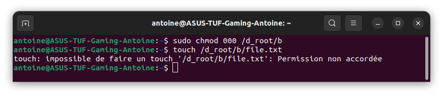](Images/Exo9/E9_Q5.png)

### Exercice 10 - Modification de contenu de fichiers

#### Q1 Télécharger le fichier https://www.gnu.org/licenses/gpl-3.0.txt dans un répertoire tmp de votre compte ; quel est le débit moyen de téléchargement et l’IP du serveur Web qui a répondu ?

```bash
mkdir ~/tmp
cd ~/tmp
wget https://www.gnu.org/licenses/gpl-3.0.txt 2>&1
```
Résultat :

[](Images/Exo10/E10_Q1.png)

On peut voir que le débit moyen de téléchargement est de 154KB/s et l'IP du serveur Web qui a répondu est 2001:470:142:5::116.

#### Q2 Créez un fichier gpl-4.0.txt en remplaçant "Copyright (C) 2007" par "Copyright (C) 2021"

```bash
sed 's/2007/2021/' gpl-3.0.txt > gpl-4.0.txt
```

#### Q3 Vérifiez les différences entre les 2 fichiers

```bash
diff gpl-3.0.txt gpl-4.0.txt
```
Résultat :

[](Images/Exo10/E10_Q3.png)

#### Q4 Créez le fichier gpl-4.1.txt à partir du fichier gpl-4.0.txt afin que "version 3" ou "Version 3" soient remplacés par "version 4" ou "Version 4"

```bash
sed 's/version 3/version 4/g' gpl-4.0.txt > gpl-4.1.txt
sed -i 's/Version 3/Version 4/g' gpl-4.1.txt
```

#### Q5 Vérifiez les différences entre les 2 fichiers (4 lignes doivent être modifiées)

```bash
diff gpl-4.0.txt gpl-4.1.txt
```
Résultat :

[](Images/Exo10/E10_Q5.png)

#### Q6 Chaque partie dispose d’un titre numéroté. Créez un fichier gpl-4.2.txt où le format des titres est changé : "0. Definitions" devient "[0] Definitions"

```bash
sed 's/\([0-9]\+\)\. /\[\1\] /g' gpl-4.1.txt > gpl-4.2.txt
diff gpl-4.1.txt gpl-4.2.txt
```
Résultat :

[![sed 's/\([0-9]\+\)\. /\[\1\] /g' gpl-4.1.txt > gpl-4.2.txt](Images/Exo10/E10_Q6.png)](Images/Exo10/E10_Q6.png)

### Exercice 11 - Chemin et raccourci

#### Q1 Dans un répertoire tmp, copiez le code C ci-dessous dans un fichier main.cpp, compilez le et exécutez le

```cpp
# include <iostream>
int main() {
std::cout << "Hello" << std::endl;
return 0;
}
```

```bash
mkdir ~/tmp
cd ~/tmp
echo '# include <iostream>' > main.cpp
echo 'int main() {' >> main.cpp
echo 'std::cout << "Hello" << std::endl;' >> main.cpp
echo 'return 0;' >> main.cpp
echo '}' >> main.cpp
g++ main.cpp -o main
./main
```
Résultat :

[](Images/Exo11/E11_Q1.png)

#### Q2 Depuis la racine de votre compte, exécutez le programme précédent sans spécifier le chemin

```bash
cd
export PATH=$PATH:~/tmp
main
```
Résultat :

[](Images/Exo11/E11_Q2.png)

#### Q3 Créez une nouvelle commande "ll" qui exécutera la commande "ls -l"

```bash
echo "alias ll='ls -l'" >> .bashrc
ll
```
Résultat :

[](Images/Exo11/E11_Q3.png)

#### Q4 Rendez la commande permanente

```bash
source ~/.bashrc
```

#### Q5 Affichez l’heure au niveau du prompt

```bash
echo "PS1='\t \u@\h:\w\$ '" >> .bashrc
source ~/.bashrc
```
Résultat :

[](Images/Exo11/E11_Q5.png)

### Exercice 12 - AWK

#### Q0 Créez un fichier `salaires.txt` avec le contenu suivant

```bash
echo "Arne 182 0\nMarie 190 0\nVishal 213 150\nGrete 192 16\nFinn 192 37\nKari 220 145\nArnfinn 220 150\nTorstein 250 132\nTrude 196 150\nGeir 160 13\nHoda 196 42" > salaires.txt
```

#### Q1 Calculez le salaire mensuel de chaque employé, mais seulement ceux qui ont travaillé plus de 0 heures

```bash
awk '{ if ($3 > 0) { salaire = $2 * $3; print $1, salaire } }' salaires.txt
```

#### Q2 Imprimez les noms des employés qui ont un salaire horaire supérieur à 200

```bash
awk '{ if ($2 > 200) { print $1 } }' salaires.txt
```

#### Q3 Imprimer les lignes pour les employés avec un nom de plus de 6 caractères

```bash
awk '{ if (length($1) > 6) { print } }' salaires.txt
```

#### Q4 Calculez le nombre des employés en utilisant les blocs BEGIN et END

```bash
awk 'BEGIN { count = 0 } { count++ } END { print count }' salaires.txt
```

*Pour compiler ce fichier markdown, j'ai utilisé la commande suivante :*
```bash
pandoc Tp8.md -o Tp8.pdf
```

*Pour resoudre l'erreur "Error producing PDF.
! LaTeX Error: Unicode character ̀ (U+0300)
not set up for use with LaTeX.
", j'ai utilisé la commande suivante :*
```bash
pandoc Tp8.md -o Tp8.pdf --pdf-engine=xelatex
```
