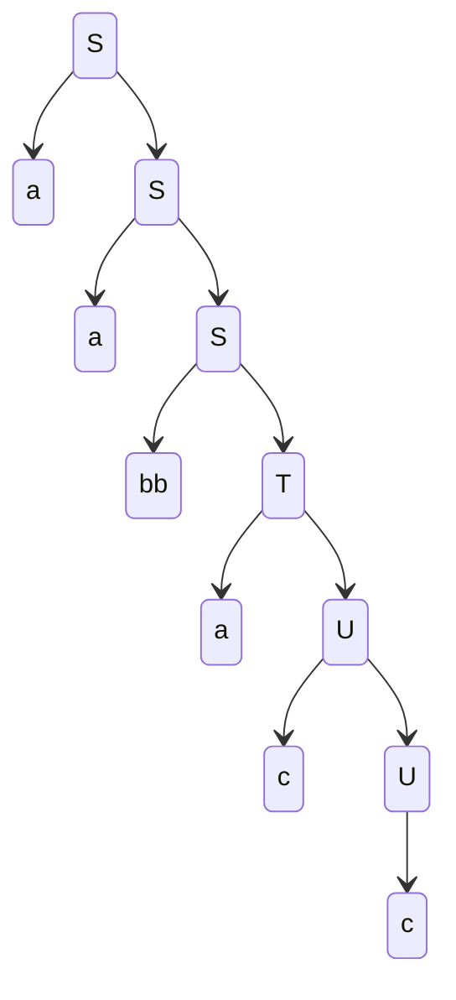
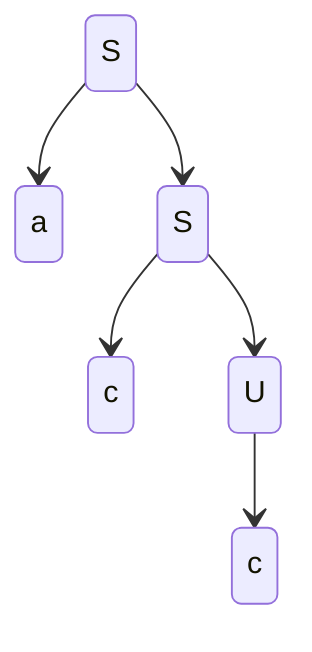
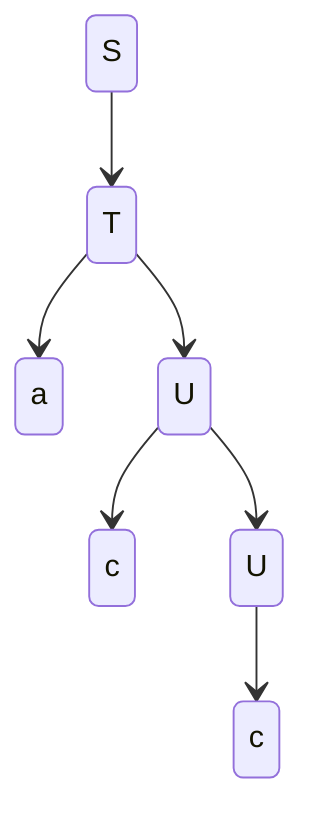
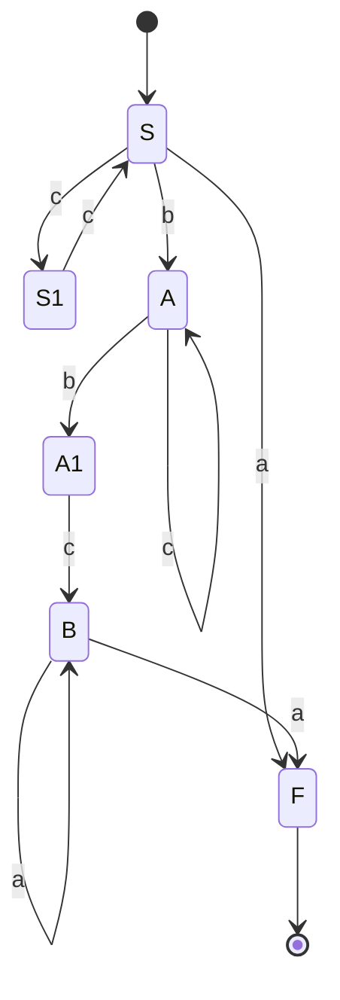
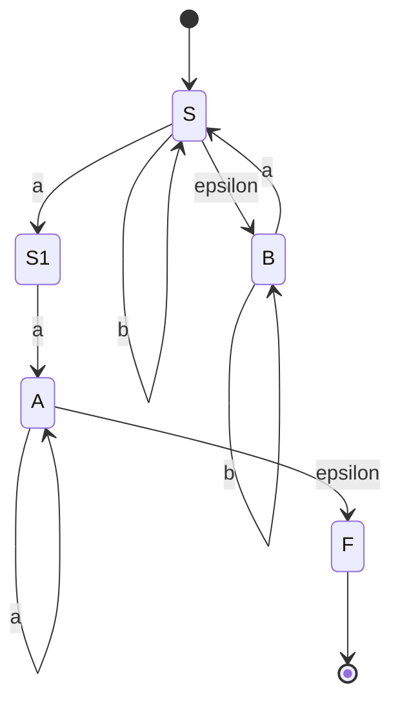

# Exercice 1
## A. Quelle est la complexité temporelle de l'algorithme de Needleman-Wunsch ?
La complexité temporelle de l'algorithme de Needleman-Wunsch est polynomiale, $O(n*m)$.

## B. Dans quels cas l'alignement local de séquences est utilisé ?
L'alignement local de séquences est utilisé pour aligner une séquence avec une partie d'une autre séquence.

# Exercice 2
## A. En déroulant l'algorithme de Needleman-Wunsch de manière détaillée, aligner les séquences $S_{1} = AGGCT$ et $S_{2} = AGCTAT$.

|     | -   | A   | G   | G   | C   | T   |
| --- | --- | --- | --- | --- | --- | --- |
| -   | 0   | -1  | -2  | -3  | -4  | -5  |
| A   | -1  | 2   | 1   | 0   | -1  | -2  |
| G   | -2  | 1   | 4   | 3   | 2   | 1   |
| C   | -3  | 0   | 3   | 2   | 5   | 4   |
| T   | -4  | -1  | 2   | 1   | 4   | 7   |
| A   | -5  | -2  | 1   | 0   | 3   | 6   |
| T   | -6  | -3  | 0   | -1  | 2   | 5   |
Un alignement optimal possible pour ces séquences est :
$$
\begin{matrix}
A & G & G & C & - & - & T \\
A & - & G & C & T & A & T
\end{matrix}
$$

## B. Existe-t-il des alignements co-optimaux pour ces deux séquences ? Justifier
Pour ces deux séquences, il existe des alignements co-optimaux, car il est par exemple possible de les aligner de manière optimale de la façon suivante :
$$
\begin{matrix}
A & G & G & C & T & - & - \\
A & - & G & C & T & A & T
\end{matrix}
$$

## C. Donner le score de l'alignement multiple suivant en utilisant le principe de la somme des paires.
$$
\begin{matrix}
A & - & T & C & C & A \\
A & G & T & T & - & G \\
- & C & T & G & C & A \\
- & - & - & - & - & - \\
2 & -1 & 2 & -2 & -1 & -2 \\
-1 & -1 & 2 & -2 & 2 & 2 \\
-1 & -2 & 2 & -2 & -1 & -2 \\
= & = & = & = & = & = \\
0 & -4 & 6 & -6 & 0 & -2
\end{matrix}
$$

Le score de l'alignement multiple est $0-4+6-6+0-2=-6$

# Exercice 3
## A. $\{a^{n}b^{m} \mid 0 \leq n \leq m+1\}$
Alphabet terminal : $\Sigma = \{a, b\}$
Axiome : $S$
Règles de production :
1. $S \to aT \mid T$
2. $T \to aTU \mid \epsilon$
3. $U \to bU \mid \epsilon$

## B. $\{a^{n}b^{n}c^{m}d^{m} \mid n, m \geq 0\}$
Alphabet terminal : $\Sigma = \{a, b, c, d\}$
Axiome : $S$
Règles de production :
1. $S \to TU$
2. $T \to aTb \mid \epsilon$
3. $U \to cUd \mid \epsilon$

## C. $\{a^{n}b^{m}c^{p}d^{q} \mid n+q = m + p\}$
Alphabet terminal : $\Sigma = \{a, b, c, d\}$
Axiome : $S$
Règles de production :
1. $S \to A^{1}D \mid A^{2}D \mid \epsilon$
2. $A^{1} \to aA^{1}c \mid A^{2} \mid \epsilon$
3. $A^{2} \to aA^{2}b \mid \epsilon$
4. $D \to cDd \mid \epsilon$
*Faux, mais meilleure approximation trouvée*

# Exercice 4
## A. Quel est le langage reconnu par cette grammaire ?
$\{a^{n}(bb)^{m}a^{m}c^{l} \mid l \geq 1\ \ ; n, m \geq 0\}$

## B. Donner un arbre de dérivation pour le mot $w=aabbacc$

## C. Cette grammaire est elle ambigüe ? Justifier
Cette grammaire est ambigüe, car si on prend par exemple le mot $w=acc$, il est possible de le construire d'au moins 2 manières différentes :

# Exercice 5
## A.

## B.

