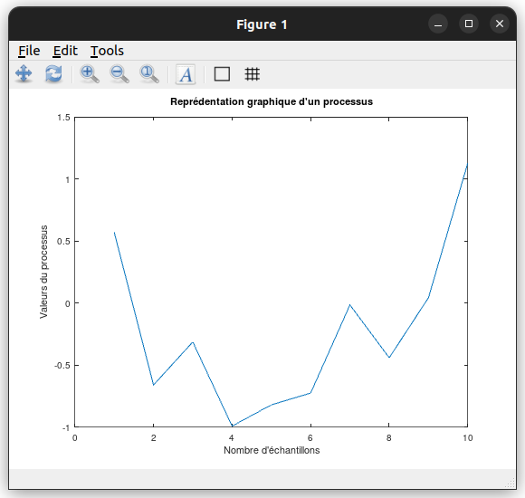
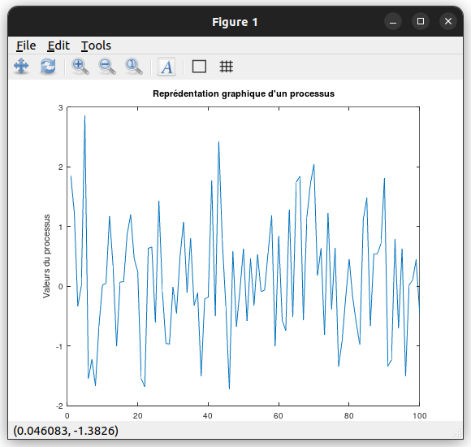
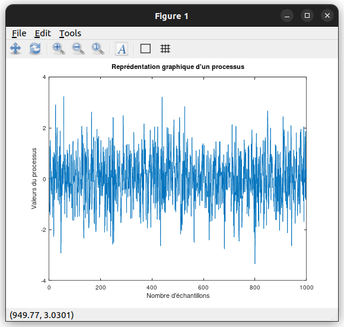
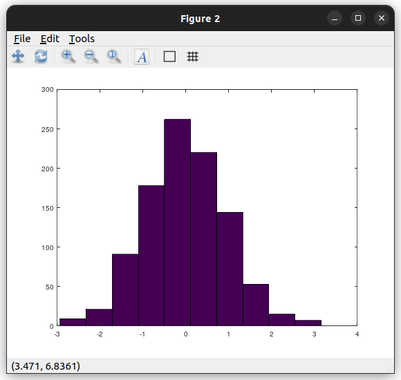
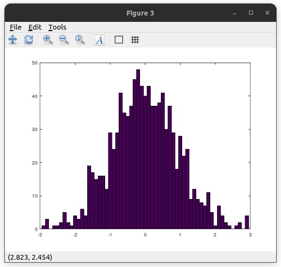
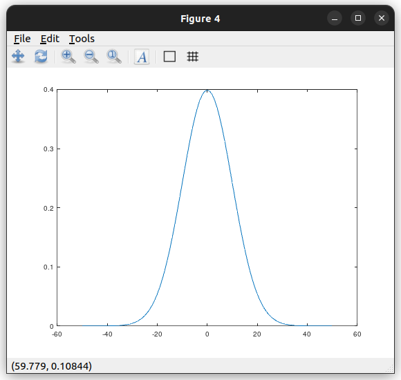
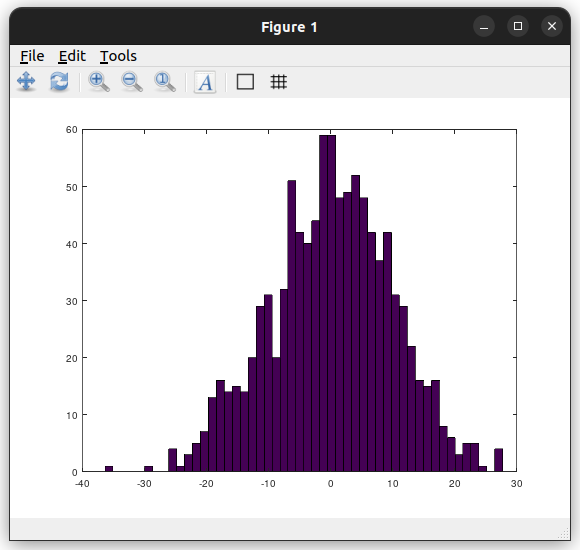
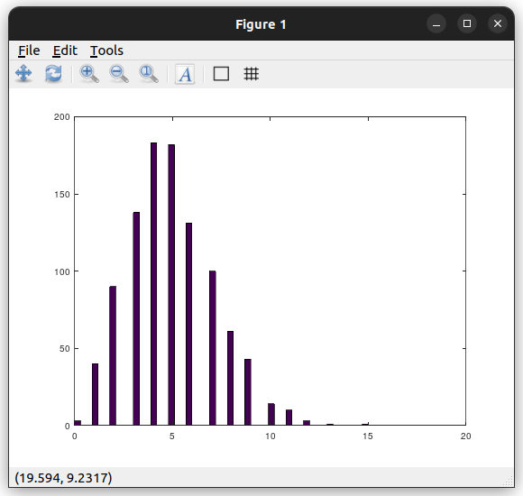

# TDM Simulation de variables aléatoire

## 1. Simulation des lois gaussiennes

### Exercice 1 : Loi Normale, Densité de probabilité

Grâce à la commande `help`, on peut trouver que la fonction `figure` permet de créer une nouvelle fenêtre graphique. On peut aussi trouver que la fonction `plot` permet de tracer des courbes.

On peut observer le résultat suivant pour N = 10; N = 100; et N = 1000

[](screenshots/exo1graph1n10.png)
[](screenshots/exo1graph1n100.png)
[](screenshots/exo1graph1n1000.png)

Voici les figures 2 et 3 pour N = 1000 :

[](screenshots/exo1graph2.png)
[](screenshots/exo1graph3.png)

Les différences que l'on peut observer entre les figures 2 et 3 sont les suivantes :
- La figure 2 a un nombre de barres M = 10, tandis que la figure 3 a un nombre de barres M = (2.9 - (-2.9))/0.1 = 58
- L'axe des abscisses de la figure 3 va de -3 à 3, tandis que l'axe des abscisses de la figure 2 n'est pas défini

En prenant en compte ces différences, il semblerait que la figure 3 permette une visualisation des données plus précises que la figure 2.

Pour construire le vecteur $fx$ contenant les valeurs de la fonction $f(x)$ prise pour les différents points de $x$, on peut utiliser le code suivant :

```matlab
x = -50:0.1:50;
m = 0;
theta = 10;
fx = (1/sqrt(2*pi))*exp(-0.5*((x-m)/theta).^2);
figure(4)
plot(x,fx)
```

Voici le graphique obtenu pour $m = 0$ et $\theta = 10$ :

[](screenshots/exo1graph4.png)

### Exercice 2 : Méthode de Box-Müller

1. En utilisant la proposition 1, écrire une fonction de paramètres $n$ simulants $n$ réalisations de la loi normale centrée réduite $N(0,1)$.

```matlab
function [X1, X2] = box_muller(n)
    U1 = rand(1,n);
    U2 = rand(1,n);
    X1 = sqrt(-2*log(U1)).*cos(2*pi*U2);
    X2 = sqrt(-2*log(U1)).*sin(2*pi*U2);
endfuction
```

2. Ecrire une fonction de paramètres $n$, $m$ et $\theta$ simulant $n$ réalisations d'une loi normale $N(m,\theta)$.

```matlab
function [X] = normale(n, m, theta)
    [X1, X2] = box_muller(n);
    X = m + theta*X1;
endfuction
```

En testant les fonctions `box_muller` et `normale`, avec le code suivant :

```matlab
X = normale(1000, 0, 10);
figure(1)
hist(X, 50)
```

On obtient le graphique suivant :

[](screenshots/exo2graph1.png)

## Génération d'une variable aléatoire discrète

### Exercice 3 : Loi de Poisson

1. Déterminer la moyenne et la variance de la loi de $X$.

La moyenne de la loi de Poisson est donnée par :

$$E(X) = \sum_{k=0}^{+\infty} kP_x(k) = \sum_{k=0}^{+\infty} k\frac{a^k}{k!}e^{-a} = \sum_{k=1}^{+\infty} \frac{a^k}{(k-1)!}e^{-a} = a\sum_{k=1}^{+\infty} \frac{a^{k-1}}{(k-1)!}e^{-a} = a\sum_{k=0}^{+\infty} \frac{a^k}{k!}e^{-a} = a$$

La variance de la loi de Poisson est donnée par :

$$V(X) = E(X^2) - E(X)^2 = \sum_{k=0}^{+\infty} k^2P_x(k) - a^2 = \sum_{k=0}^{+\infty} k^2\frac{a^k}{k!}e^{-a} - a^2 = \sum_{k=1}^{+\infty} k\frac{a^k}{(k-1)!}e^{-a} - a^2 = a\sum_{k=1}^{+\infty} k\frac{a^{k-1}}{(k-1)!}e^{-a} - a^2 = a\sum_{k=0}^{+\infty} (k+1)\frac{a^k}{k!}e^{-a} - a^2 = a(a+1) - a^2 = a$$

2. Déterminer la relation de récurrence qui donne $P_x(k)$ en fonction de $P_x(k-1)$, ainsi que celle donnant $S(k)=P(X \leq k)$.

La relation de récurrence qui donne $P_x(k)$ en fonction de $P_x(k-1)$ est la suivante :

$$P_x(k) = \frac{a^k}{k!}e^{-a} = \frac{a}{k}\frac{a^{k-1}}{(k-1)!}e^{-a} = \frac{a}{k}P_x(k-1)$$

La relation de récurrence qui donne $S(k)=P(X \leq k)$ est la suivante :

$$S(k) = \sum_{i=0}^{k} P_x(i) = \sum_{i=0}^{k} \frac{a^i}{i!}e^{-a} = e^{-a}\sum_{i=0}^{k} \frac{a^i}{i!} = e^{-a}\sum_{i=0}^{k} P_x(i) = e^{-a}S(k)$$

3. En utilisant (I), écrire un programme qui engendre une variable aléatoire de Poisson de paramètre $a=5$, à partir d'une variable aléatoire $U$ qui suit la loi uniforme sur $[0,1]$.

```matlab
function [X] = poisson(n, a)
    X = zeros(1,n);
    for i = 1:n
        k = 0;
        p = exp(-a);
        F = p;
        U = rand;
        while U > F
            k = k + 1;
            p = a*p/k;
            F = F + p;
        endwhile
        X(i) = k;
    endfor
endfuction
```

4. En utilisant la fonction `hist`, vérifier le résultat obtenu.

```matlab
X = poisson(1000, 5);
figure(1)
hist(X, 50)
```

On obtient le graphique suivant :

[](screenshots/exo3graph1.png)