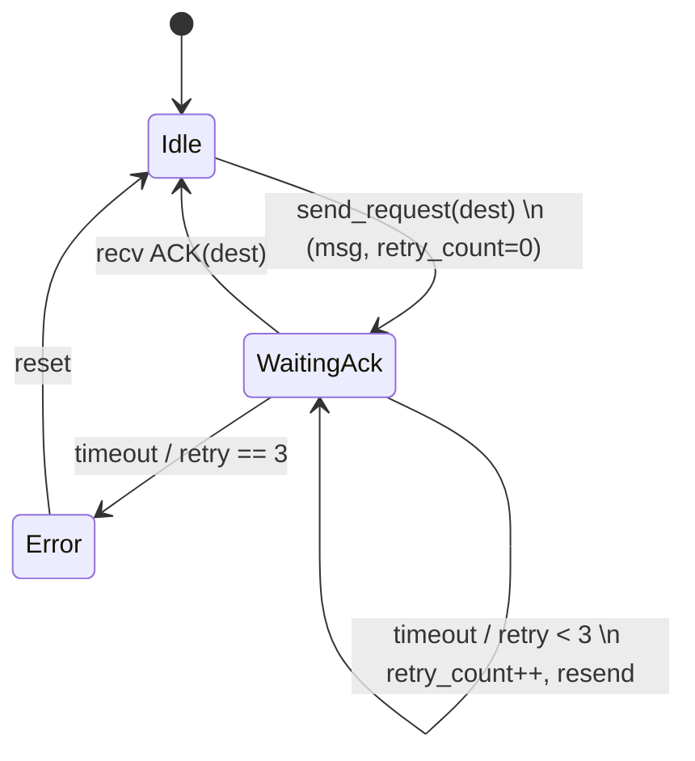
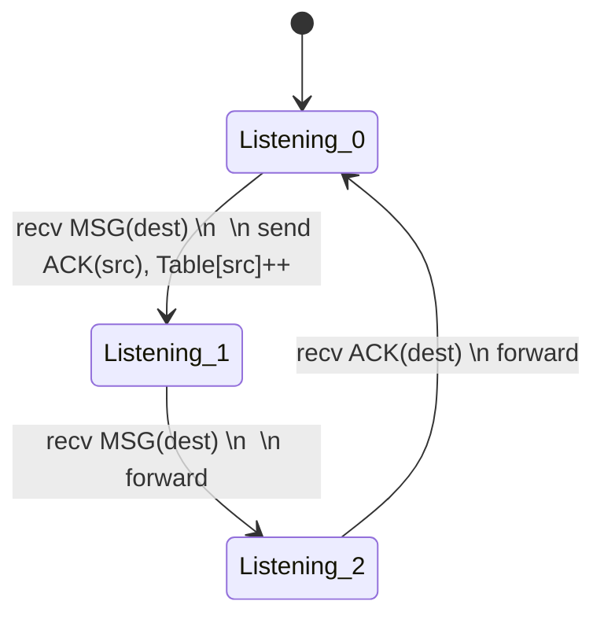

# Exercice 1
Q1 -> A
Q2 -> C
Q3 -> B
Q4 -> C ; E ; F
Q5 -> D
Q6 -> B ; C ; D
Q7 -> B
Q8 -> C
Q9 -> A
Q10 -> D
Q11 -> A
Q12 -> C (probablement **E**rror**ADDR**ess**INUSE**)

# Exercice 2
### Client

### Serveur

*Les 3 listening sont les même, c'est uniquement pour l'affichage correct du diagramme*

# Exercice 3
### Q1.
Dans un header IPv4, les adresses sont aux octets 13-16 pour la source et 17-20 pour la destination, ce qui donne :
- **Source :** c0 a8 01 10 = 192.168.1.16
- **Destination :** 33 0f b1 11 = 51.15.177.17

### Q2.
Le champ protocol du header IPv4 est situé sur l'octet numéro 10. Dans notre cas, il s'agit de 11, ce qui donne 17 en décimal, qui correspond bien a un datagramme UDP.

### Q3.
On peut voir dans l'en-tête UDP (a partir de l'octet 21), le port source est le 00 7b, ce qui correspond a 123, et celui de destination est le 00 38, ce qui correspond a 56.
On peut trouver que le port 123 est celui du service NTP.

### Q4.
En utilisant la même démarche, on peut trouver que le protocol est 06, ce qui correspond a TCP, et que les ports source et destination sont 32944 (80 b0) et 80 (00 50). Le port 80 correspond au service HTTP

### Q5. (traduction hexa vers ascii par ChatGPT)
Il s'agit du même protocole est du même service que pour la question précédente.
Dans la partie data, on peut lire une en-tête HTTP :
47 45 54 20 2F 20 48 54 54 50 2F 31 2E 31 0D 0A → GET / HTTP/1.1\r\n
48 6F 73 74 3A 20 77 77 77 2E 65 78 61 6D 70 6C 65 2E 63 6F 6D 0D 0A  → Host: www.example.com\r\n
0D 0A → ligne vide de fin d’entête

### Q6. (ChatGPT)
Ces deux trames sont des trames du protocole ARP (Address Resolution Protocol)
##### Trame 1
0001    ➔ Hardware Type = Ethernet (1)
0800    ➔ Protocol Type = IPv4 (0x0800)
06      ➔ Hardware size = 6 (adresse MAC sur 6 octets)
04      ➔ Protocol size = 4 (adresse IPv4 sur 4 octets)
0001    ➔ Opcode = 1 (ARP Request)
20:7b:d2:2d:9f:69 ➔ adresse MAC de l’émetteur (192.168.1.16)
c0:a8:01:10       ➔ adresse IP de l’émetteur (192.168.1.16)
00:00:00:00:00:00 ➔ adresse MAC cible inconnue
c0:a8:01:01       ➔ IP cible recherchée (192.168.1.1)
**La machine 192.168.1.16 interroge donc « Qui a l’IP 192.168.1.1 ? Quel est ton MAC ? »**
##### Trame 2
0001    ➔ Hardware Type = Ethernet
0800    ➔ Protocol Type = IPv4
06      ➔ Hardware size = 6
04      ➔ Protocol size = 4
0002    ➔ Opcode = 2 (ARP Reply)
08:87:c6:36:9c:a0 ➔ adresse MAC de la machine qui possède 192.168.1.1
c0:a8:01:01       ➔ IP de l’émetteur (192.168.1.1)
20:7b:d2:2d:9f:69 ➔ MAC destinataire (la 192.168.1.16 qui a fait la requête)
c0:a8:01:10       ➔ IP destinataire (192.168.1.16)
**Le routeur (ou hôte) à 192.168.1.1 répond donc avec sa MAC.**

Ethernet impose une taille minimale de trame de 64 octets. Si la partie utile (ici l’ARP header de 28 octets) est trop courte, on padde avec des zéros pour atteindre cette longueur minimale.

---

En résumé, ce sont deux trames ARP :
1. Request de 192.168.1.16 (opcode 1)
2. Reply de 192.168.1.1 (opcode 2)

Et les octets nuls qui suivent servent simplement de padding pour que la trame atteigne la taille minimale Ethernet.

# Exercice 4
### Q1.
Bande passante : $C = 500 Mbit/s$
Vitesse de propagation : $v = 2·10^8 m/s$
Délai de traitement : négligeable, $+ 1,5 µs$ supplémentaire par km

##### A.

**RTT**
- Propagation aller-retour :
	- $T_\text{propagation,1-way} = \frac{1052\,\text{km}}{2\cdot10^5\,\text{km/s}} = 0{,}00526\,\text{s}$
- Délai additionnel (1,5 µs/km) aller-retour :
	- $2 \times (1052\,\text{km} \times 1{,}5\cdot10^{-6}\,\text{s/km}) = 2 \times 0{,}001578\,\text{s} = 0{,}003156\,\text{s}$
- RTT total :
	- $\text{RTT} = 0{,}00526 + 0{,}003156 \approx 0{,}008416\,\text{s}$

**Temps de transmission** d’un paquet de 1 Ko = 8 192 bits
- $T_\text{tx} = \frac{8\,192}{500\times10^6} = 1{,}6384\cdot10^{-5}\,\text{s}$

**Fenêtre nécessaire** pour occuper 100 % du lien :
- $N_{\!100\%} \approx \frac{\text{RTT}}{T_\text{tx}} = \frac{0{,}008416}{1{,}6384\cdot10^{-5}} \approx 514$
Mais on ne veut utiliser que 75 % de la bande passante, donc
- $N = 0{,}75\times514 \approx 386$

On prend **N = 386** (nombre entier de trames en vol).

##### B.
$\text{bits} = \lceil \log_2(N+1)\rceil = \lceil \log_2(387)\rceil = 9$
On a donc **9 bits** de champ de séquence.

### Q2.
##### A.
On souhaite transférer 1 To ($≈10^{12}$ octets) :
**Sur la fibre :**    
$$T_\text{fibre} = \frac{1\cdot10^{12}\times8}{500\cdot10^6} = 1,6\times10^4\,\text{s} ≃ 4,44\,\text{h}$$
**Sur le TGV :**
$$T_\text{TGV} = \frac{1052}{320}\,\text{h} ≃ 3,29\,\text{h}$$

La fibre (4,44 h) est plus lente que le TGV (3,29 h) pour acheminer 1 To.

##### B.
Pour que la fibre devienne plus rapide, on pourrait augmenter la bande passante.

##### C.
Si on passe à 750 Mbit/s, on peut augmenter la taille de la fenêtre N du protocole Go-Back-N.